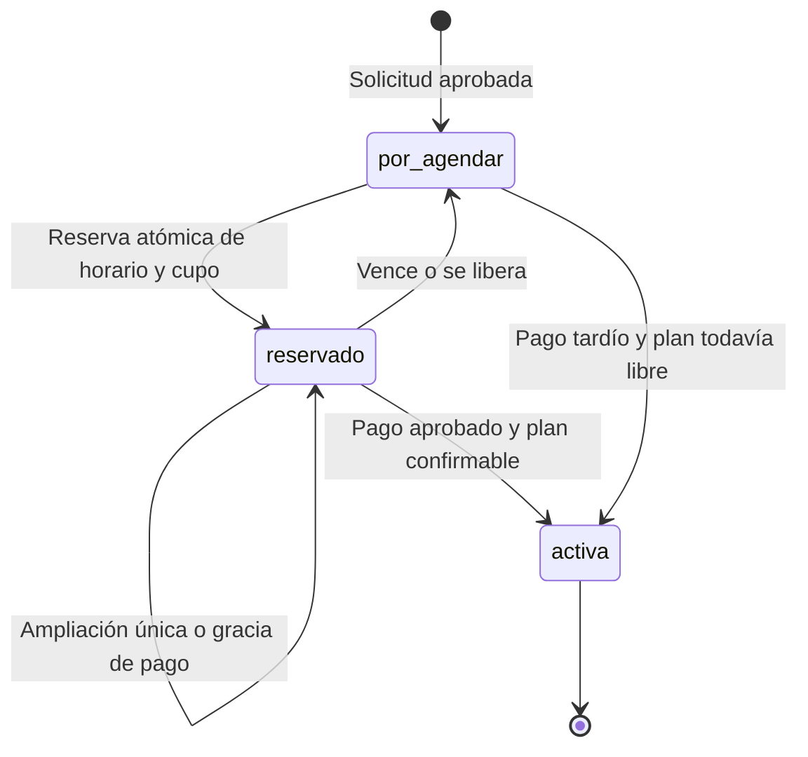
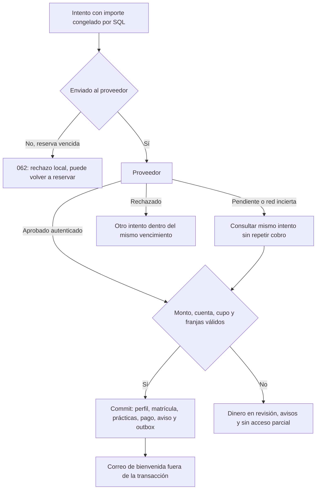

# Alumno aprobado: reservas, pagos y acceso (I01–I14)

I01–I14 implementadas. No se ejecutaron suites por autorización vigente; la única
verificación SQL fue el arnés F45 aislado. **058 → 059 → 060 → 061 → 062 están
pendientes de aplicación remota** por el operador. 056/057 ya aplicadas según el
usuario; 057 intacta. 063–064 siguen reservadas.

## Estados y compatibilidad



La etapa no sustituye el enum administrativo: por_agendar y reservado conservan
status pendiente_cohorte e importe null; la cohorte reservada es tentativa. Solo
la confirmación de pago crea prácticas definitivas y cambia la matrícula y el
status del perfil a activo, dentro de la misma transacción. La cuenta sigue
restringida si cualquiera de sus matrículas vigentes está incompleta.
Manuales y existentes reciben etapa activa por 058 sin convertir estados,
cohortes, importes ni prácticas. No convertir la matrícula antigua de ensayo.



Kushki usa Hosted Fields: PAN/CVV se introducen en sus campos y nuestro API recibe
solo un token opaco. No se guardan números de tarjeta, CVV, tokens ni cuerpos de
webhook en ledger o logs. Manual y simulado no solicitan tarjeta.

## Supuestos de horario y dinero

- Una cohorte contiene todo el plan. Se elige por inicio de curso e id, del mismo
  curso, con matrícula abierta hoy en Guayaquil y cupo para activas y reservas vigentes.
- La última práctica queda al menos COHORT_MARGIN_DAYS (5 por defecto) días antes
  del fin del curso. Instructor automático por franja, oculto hasta pagar.
- Hora fija y plan automático (I15): el alumno elige modalidad, fecha de inicio (desde
  mañana), 1–6 horas al día y una hora de inicio 06–21; el servidor arma bloques de una
  hora consecutivos desde esa hora, termina a más tardar a las 22:00 y recorta el último
  día para cubrir exactamente horas_requeridas. No se consideran feriados.
  Una práctica física disponible/liberada también ocupa el calendario del instructor;
  no se sobrescribe para otro plan o cohorte.
- Un lease vencido no ocupa franja ni cupo, incluso sin cron. Las lecturas y acciones
  propias limpian vencidas; el cron por minuto procesa lotes de 100, concurrencia 5.
  El contador del navegador es informativo: la autoridad es el reloj SQL.
- El importe completo se calcula en SQL: precio de cohorte más recargo servidor.
  Moneda USD, centavos enteros. IVA=0 es una constante pendiente de definición fiscal,
  no una conclusión sobre exención legal. Se congela el desglose en el intento.
- El comprobante de efectivo es una referencia textual opcional, no un archivo.
  Un pago recibido que no puede activar queda en revisión; no se inventa un reembolso
  automático ni un plazo de conservación financiera. Deben definirse antes de producción.

## Variables

| Backend                   | Default / requisito                                               |
| ------------------------- | ----------------------------------------------------------------- |
| RESERVA_TTL_MINUTES       | 15; entre 1 y 15                                                  |
| RESERVA_MAX_EXTENSIONES   | 1; entre 0 y 1                                                    |
| RESERVA_EXTENSION_MINUTES | 10; entre 1 y 10                                                  |
| RESERVA_MAX_POR_DIA       | 3; entre 1 y 3, fecha Guayaquil; liberar no devuelve el intento   |
| PAGO_GRACIA_MINUTES       | 10; entre 1 y 10, una sola gracia aunque haya rechazos            |
| COHORT_MARGIN_DAYS        | 5; entre 0 y 60                                                   |
| PAYMENT_PROVIDER          | simulado en desarrollo/test; manual en producción; también kushki |
| PAYMENT_SURCHARGE_CENTS   | 0; entero entre 0 y 1000000                                       |
| KUSHKI_ENVIRONMENT        | uat; production con certificación y credenciales correspondientes |
| KUSHKI_PUBLIC_KEY         | obligatoria solo con Kushki; pública, entregada al checkout       |
| KUSHKI_PRIVATE_KEY        | obligatoria solo con Kushki; solo backend                         |
| KUSHKI_WEBHOOK_SECRET     | obligatoria solo con Kushki; secreto de firma del comercio        |
| KUSHKI_MERCHANT_ID        | obligatoria solo con Kushki; coincide con X-Kushki-Key            |
| EMAIL_PROVIDER            | console para ensayo local; smtp/gmail_api conservados             |
| DISABLE_CRON              | true local; la limpieza perezosa sigue funcionando                |

No se editó `.env`. `.env.example` contiene solo valores ficticios o claves vacías.
Frontend conserva NEXT_PUBLIC_API_URL y las claves públicas Supabase existentes;
no necesita variables públicas nuevas para claves privadas o secreto de Kushki.
Simulado se niega a arrancar con NODE_ENV=production; console y captcha off conservan
sus guardas de producción. F43 sigue pendiente antes de cualquier despliegue real.

## Aplicación manual

1. Respaldar y comprobar [orden de migraciones](inscripcion-orden-migraciones.md).
   No ejecutar SQL desde la aplicación ni durante ensayos HTTP.
2. Aplicar **058 → 059 → 060 → 061 → 062**. Para cada número: preflight, migración,
   verificación terminada en ROLLBACK y revisión del resultado antes de continuar.
   Los archivos están en esta carpeta y `migrations/`. No modificar 057.
3. Preflight 060 falla si payments ya existe; no repetir a ciegas. Las huellas de
   funciones detienen una modificación manual desconocida. Coordinar runtime y esquema.
4. Comprobar RLS sin políticas, tablas sin privilegios anon/authenticated y funciones
   propias con EXECUTE solo service_role. Conservar los dos helpers privados de Realtime
   autorizados; no modificar extensiones ni esquemas realtime/storage.
5. Rollback en orden inverso. 062 conserva eventos y rechazos ya registrados; 060/059
   se niegan a destruir historial financiero o de reservas. No vaciar tablas para forzarlos.

Runbooks específicos: [058](inscripcion-058.md), [059](inscripcion-059.md),
[060](inscripcion-060.md), [061](inscripcion-061.md), [062](inscripcion-062.md).

## Inicio local por el operador, en dos terminales

Desde la raíz del workspace, terminal 1 (conservar credenciales locales existentes):

```sh
cd coloradosdrive-backend
PORT=3000 NODE_ENV=development EMAIL_PROVIDER=console CAPTCHA_PROVIDER=off DISABLE_CRON=true PAYMENT_PROVIDER=simulado npm run dev
```

Terminal 2, desde la misma raíz:

```sh
cd coloradosdrive-frontend
NEXT_PUBLIC_API_URL=http://localhost:3000 npm run dev
```

API: http://localhost:3000/health y http://localhost:3000/public/courses.
Formulario: http://localhost:3001/inscripcion. Admin: /admin/solicitudes y
/admin/students. Alumno: /student/inscripcion, /student/schedule, /student/documents
y /student/history, todas bajo http://localhost:3001.

El código de seis dígitos y el enlace para crear contraseña aparecen en la terminal
**del backend**, en bloques [CORREO SIMULADO]; no están en CircleCI ni en el navegador.
Console no envía correos a internet. La bienvenida de pago no lleva contraseña ni
un nuevo enlace Auth: la contraseña se creó con el enlace de aprobación anterior.

## Guion manual de aceptación, pendiente de ejecución

Usar proyecto/cuentas de ensayo y datos ficticios. Correo:
postulante-prueba-<sufijo>@example.com; mayor de 18, sangre O+, nivel bachiller y
cédula ficticia válida según el validador del proyecto. No publicar datos reales.

1. Preparar curso de 15 horas, cohorte con matrícula abierta hoy, cupo mínimo 1 y
   fechas que contengan el plan más margen de 5 días. Instructor habilitado y libre.
2. Completar el formulario público, leer código en consola, confirmar, aceptar
   versiones vigentes, completar datos/estudios y enviar la solicitud.
3. Admin verifica identidad/estudios con métodos válidos de ensayo y aprueba. Debe
   crear cuenta sin contraseña y enlace de un solo uso, sin cohorte ni importe,
   matrícula por_agendar. Crear contraseña con el enlace impreso y entrar como alumno.
4. Solo inscripción, contraseña, notificaciones y salir. Acceso directo a exámenes,
   horarios o historial debe redirigir; API responde 403 INSCRIPCION_INCOMPLETA.
5. Paso 1: identidad/estudios verificados y checklist físico. Ensayar además no_sabe
   y papeleta exenta desde 65 años. No debe existir subida digital desde el alumno.
6. Paso 2: elegir modalidad, fecha de inicio, horas por día y una hora de inicio (ficha).
   Con 3 horas por día y 07:00 el plan es 5 días de 07:00 a 10:00; con 6 horas, 3 días
   (6, 6, 3). Fecha en fin de semana con entre_semana: el plan empieza el lunes y lo
   dice. Las horas sin instructor o sin cohorte aparecen deshabilitadas con su razón y
   no hay casillas clicables. Resumen en una frase y cohorte tentativa «se confirma al
   reservar»; sin instructores visibles. «Reservar este horario» inicia el contador.
7. Reservar: contador global de 15 minutos, recargar conserva el plan. Ampliar una vez
   añade 10 minutos; una segunda ampliación se deniega. Liberar pide confirmación;
   la cuarta reserva del día se bloquea y liberar no devuelve intentos diarios.
8. Vencer con cron apagado: libera cupo/franjas, avisa en bandeja y vuelve al paso 2.
   Conserva solicitud, cuenta y sesión; no envía correo de vencimiento.
9. Paso 3: subtotal, recargo, IVA cero y total del servidor. Crear intento y usar
   checkout simulado. Pendiente sobrevive recargar; rechazo permite otro intento sin
   renovar gracia; aprobado activa perfil/matrícula y crea todas las prácticas una vez.
10. Abandonar antes de enviar: vencer y comprobar rechazo NO_ENVIADO_VENCIDO; nueva
    reserva y pago posibles. Un pendiente ya enviado permanece pendiente tras el TTL.
11. Aprobado: menú completo, Horarios con plan e instructor propio, documentos con
    estados y plazo de la primera práctica, historial/objetivo. Bienvenida en consola;
    fallo de correo no revierte pago ni acceso. Repetición no duplica los efectos.
12. Otra cuenta: registrar efectivo en Alumnos tras ver importe y confirmar, con
    referencia opcional. Admin/actor/MFA comprobados. Liberar solo reserva sin pago;
    no liberar una con pendiente o dinero recibido. Reanudar efectivo con el mismo UUID.
13. Alumnos: pendientes true/false solo consideran etapa activa; lista general
    conserva Por agendar/Reservado. Reducir cupo bajo activas y holds vigentes devuelve
    IC409 en español y foco al campo. Un hold vencido ya no ocupa cupo.
14. Pago tardío: plan libre confirma; franjas ocupadas, reserva nueva o importe
    discordante conservan dinero en revisión y avisan a alumno/admin, sin acceso parcial.
    Producir estos casos en entorno controlado durante la fase de pruebas autorizada,
    no mediante SQL contra producción.

### Kushki por el comercio

Configurar credenciales UAT, merchant y secreto; registrar URL HTTPS /webhooks/kushki
para aprobaciones/rechazos y conservar metadata.drivePaymentId. Usar exclusivamente
[datos de prueba oficiales](https://docs.kushki.com/ec/getting-started/testing-your-integration).
Confirmar Hosted Fields, OTP/3DS, solo token hacia nuestro API y firma fuerte del cuerpo
con timestamp, merchant, ventana temporal de 185 minutos y monto/moneda exactos.
Repetir webhook no duplica efectos. Fuentes, campos y endpoints verificados en
[proveedores](inscripcion-pagos-proveedores.md). No se hicieron cobros ni certificación
con credenciales del comercio en esta tanda.

## Incidentes y operación

| Caso                      | Acción segura                                                                                                                                            |
| ------------------------- | -------------------------------------------------------------------------------------------------------------------------------------------------------- |
| Red incierta al cobrar    | Consultar el mismo intento; dispatch no se repite. No crear otro UUID para forzar cobro                                                                  |
| Checkout vacío vencido    | 062 lo rechaza solo sin dispatch; puede reservar de nuevo dentro del límite diario                                                                       |
| Pendiente sin webhook     | Verificar ticket en Kushki, firma/merchant y ruta; pedir reenvío o conciliación antes de cobrar otra vez                                                 |
| Pago en revisión          | Comparar dinero recibido/esperado y código técnico en ficha; preservar evidencia y resolver con el comercio, sin activar ni cobrar de nuevo a ciegas     |
| Correo fallido            | Pago sigue aprobado. Outbox reintenta hasta 5 veces, lease/CAS de 2 minutos y espera de 5 minutos; revisar configuración sin exponer secretos            |
| Reserva vencida           | Volver a elegir horario; solicitud/sesión siguen vigentes. Revisar límite de 3 al día                                                                    |
| Cohorte sin cupo o rango  | Elegir fechas posteriores o preparar cohorte compatible; conservar guards y holds                                                                        |
| Eliminar alumno con pagos | Pendiente/aprobado/revisión bloquea antes de ban/Storage. Definir conservación financiera; solo rechazados permiten borrar conservando ledger sin perfil |
| Cambio a proveedor manual | Mantener claves del webhook mientras haya Kushki en tránsito y continuar conciliación                                                                    |

El correo se intenta tras el commit y en consultas propias, también con cron apagado;
cron habilitado reintenta. Message-ID estable y entrega al menos una vez: una caída
tras SMTP puede repetir correo, nunca pago, prácticas ni activación. Con intentos
agotados, el operador revisa configuración y contacta al alumno; no se reabre un cobro.

## Seguridad y validación de esta entrega

JWT, rol, propiedad y MFA admin cuando aplica. Límites HMAC por sujeto y por IP en
webhook, JSON de 16 KB y no-store. Funciones con locks, sin llamadas de red dentro de
transacciones. Hashes de evento contra repetición; logs sin datos personales ni
secretos. Excepción de correo solo en console fuera de producción, sin relajar otros logs.

Backend: typecheck global, lint de src y build. Frontend: typecheck, lint y build de
aplicación; tests heredados con errores de tipos y worktrees excluidos temporalmente
del build, restaurando tsconfig sin diff. No se editaron ni ejecutaron suites.
F45 hasta 062: **62 aplicaciones, 40 preflights, 33 verificaciones y 43 rollbacks OK**.
El arnés no acredita navegador, carreras entre conexiones, red, correo/proveedor real
ni la configuración remota. Deuda detallada por tarea en el archivo local no commiteado
inscripcion-pruebas-pendientes-alumno.md.

Antes de producción: fase final de pruebas expresamente autorizada, credenciales y
certificación Kushki, definición fiscal/conservación y F43 solicitado explícitamente.
Hasta F43, los límites por correo e IP y los topes diarios son la única barrera contra bots.

## Ganchos de fases futuras, sin implementar

- Contenido descargable de profesores: relación por course_id/enrollment_id y la misma
  guarda de cuenta/etapa. No se crean buckets, subidas ni endpoints en esta entrega.
- Exámenes asignados por alumno: futura relación student_id/enrollment_id y examen,
  con propiedad/rol, conservando activeCourseIds y autorización por matrícula.
- Los módulos actuales siguen disponibles al activar; no se cambia su motor ni se
  crea contenido descargable o asignaciones individuales aquí.
