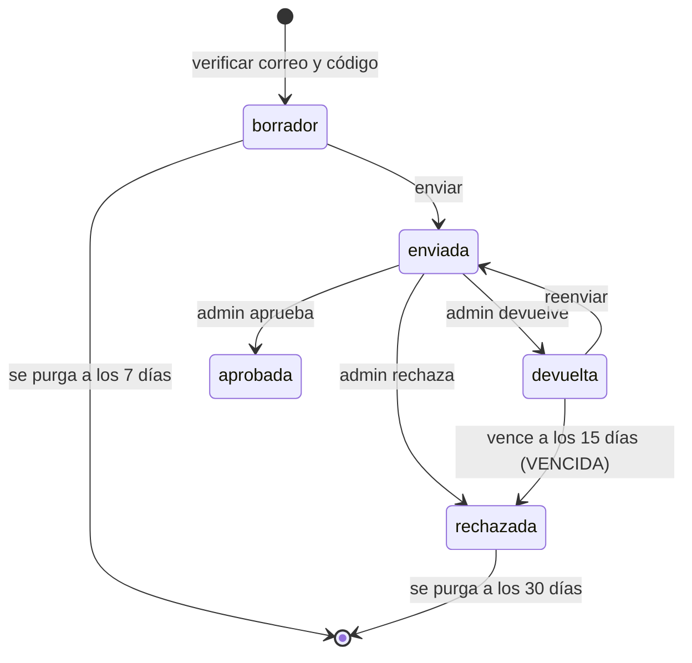

# Inscripción en línea · flujo final (consolidado)

Estado: implementado en el backend (F01 a F22, F24, F42) y el frontend (F25 a F40). Sin
pruebas ejecutadas desde la fase 2 y sin SQL aplicado. **F43 (widget Turnstile) y F23
(suite de pruebas) siguen pendientes y son requisito antes de producción.** Brief:
`inscripcion-brief.md`; orden de SQL: `inscripcion-orden-migraciones.md`.

## Flujo



Pantallas del postulante: 0 requisitos, 1 correo, 2 código, 3 consentimiento, 4 datos,
5 estudios (+ certificado si el nivel lo exige), 6 revisar y enviar, 7 estado.

## Estados y vencimientos
Borrador 7 días. Devuelta 15 días y pasa a rechazada con motivo VENCIDA. Rechazada: datos y
archivo se purgan a los 30 días (`SOLICITUD_RETENCION_DIAS`); mientras exista, ese correo no
abre otra solicitud. Certificados verificados se borran a los 30 días de verificados. Huérfanos
de Storage: 1 día. Zona horaria America/Guayaquil. SPAM bloquea el correo 30 días (solo hash).

## Endpoints
Público: `GET /public/inscripcion/config`, `POST /solicitudes/verificar-correo`,
`POST /solicitudes/confirmar-codigo`, y con token de solicitud `PUT /solicitudes/:id/consentimiento`,
`PUT /solicitudes/:id/datos`, `POST /solicitudes/:id/documentos` (multipart: `archivo` y `subtipo`),
`GET /solicitudes/:id/progreso`, `POST /solicitudes/:id/enviar`, `POST /solicitudes/:id/reenviar`.
Admin: `GET /admin/solicitudes`, `GET /admin/solicitudes/resumen`, `GET /admin/solicitudes/:id`,
`POST /admin/solicitudes/:id/verificaciones`, `GET /admin/solicitudes/:id/certificado/url`,
`POST /admin/solicitudes/:id/decision`, `DELETE /admin/solicitudes/:id`,
`GET|PUT /admin/inscripciones/config`, `POST /admin/estudiantes/:id/reenviar-enlace-acceso`.
Alumno: `GET /estudiantes/estado-inscripcion`. Instructor: `PATCH /practice-slots/:id/identidad-presencial`.
Códigos de error y diferencias de contrato: `inscripcion-contratos-backend-b1.md`, `-b2.md` y `-b3.md`.

## Variables de entorno nuevas (valores por defecto)
`CAPTCHA_PROVIDER=off` (turnstile obligatorio en producción; off no arranca), `TURNSTILE_SECRET_KEY`,
`ENROLLMENT_CODES_DAILY_CAP=250`, `ENROLLMENT_NEW_REQUESTS_DAILY_CAP=150`, `ENROLLMENT_UPLOADS_DAILY_CAP=40`,
`ENROLLMENT_UPLOADS_PER_IP_DAILY_CAP=5`, `ENROLLMENT_CODES_PER_EMAIL_DAILY_CAP=5`,
`ENROLLMENT_FAILED_CODES_PER_EMAIL_DAILY_CAP=10`, `ENROLLMENT_CODES_PER_IP_HOUR`, `ENROLLMENT_CODE_COOLDOWN_SECONDS=60`,
`ENROLLMENT_RATE_HMAC_SECRET`, `TRUST_PROXY_HOPS` (0 en desarrollo, 1 en producción: un solo proxy
delante de Railway), `PRIVACY_NOTICE_VERSION`, `TERMS_VERSION`, `TERMS_REFUND_TEXT`, `RECENT_GRAD_MONTHS=12`,
`SOLICITUD_RETENCION_DIAS=30`, `ADMIN_MFA_REQUIRED=false`, y para correo por API
`EMAIL_PROVIDER=gmail_api` con `GMAIL_CLIENT_ID`, `GMAIL_CLIENT_SECRET` y `GMAIL_REFRESH_TOKEN`.
Frontend: `NEXT_PUBLIC_TURNSTILE_SITE_KEY` (solo con F43).

## Runbook de topes
Al 80 % de un tope el resumen del admin muestra alerta. Con el tope agotado: (1) cerrar
inscripciones con el interruptor del admin, (2) subir el tope por variable de entorno y reiniciar,
(3) derivar por WhatsApp y usar la matrícula manual. Un tope de subidas agotado nunca impide
inscribirse: se envía sin archivo y el admin usa «Devolver» con REQUIERE_DOCUMENTO_ESTUDIOS.
Si una aprobación queda «en curso» porque el proceso murió, liberar a mano `reviewed_by` y
`reviewed_at` de esa solicitud (ver `inscripcion-052.md`).

## Matriz amenaza, control y prueba
| Amenaza | Control | Prueba (estado) |
|---|---|---|
| Enumeración de correos | Respuesta uniforme y piso de 300 ms (F08) | Hay pruebas; suite F23 pendiente |
| Bots y abuso | Límites HMAC por correo e IP, topes diarios persistidos | Hay pruebas; **sin captcha hasta F43** |
| Archivo hostil | Firma real, recodificación sharp, inspección de PDF, semáforo (F12) | 81 pruebas de F12 |
| Doble envío o doble aprobación | Funciones SQL con bloqueo de fila | Pruebas SQL de 048 y 049; faltan de 050 a 054 |
| Rutas sin protección | `npm run security:routes` (F22) | Ejecutado: 105 rutas, 0 sin protección |
| Cuenta de admin robada | MFA TOTP con `ADMIN_MFA_REQUIRED` (F21) | Pendiente de prueba manual |
| Contraseña por correo | Enlace de un solo uso con `token_hash` (F16) | Pendiente de prueba manual |

## Pasos manuales
1. Aplicar 042 a 054 en orden (ver `inscripcion-orden-migraciones.md`).
2. Supabase Auth: desactivar registros públicos, activar Leaked password protection, contraseña
   mínima 10, ajustar la expiración del enlace de recuperación, y definir Site URL y redirect URLs
   (dominio de Vercel y localhost). Verificar con `npm run security:check-auth`. Detalle en
   `inscripcion-mfa-auth.md`.
3. Railway: variables de arriba, `TRUST_PROXY_HOPS=1`. Vercel: variables públicas.
4. Enrolar TOTP de cada admin y solo después poner `ADMIN_MFA_REQUIRED=true`.
5. Confirmar la URL del Registro Civil en `lib/content/verificacion-links.ts` del frontend.
6. Revisión legal del aviso de privacidad y de los términos (hoy son borrador).
7. `npm audit` marca nodemailer (alta) con salto de versión mayor: decidir y quitar `continue-on-error` del CI.

## Guion de prueba manual (correo en modo console)
Con `EMAIL_PROVIDER=console`, `CAPTCHA_PROVIDER=off` y datos ficticios (cédula válida de prueba, correo
`prueba@example.com`): (1) abrir `/inscripcion?courseId=...`, marcar las 3 casillas; (2) pedir el
código y leerlo en la consola del backend; (3) aceptar consentimiento y términos; (4) llenar datos,
elegir nivel `decimo_aprobado` y subir una foto JPG pequeña; (5) revisar y enviar, ver la pantalla
«pendiente de revisión» y el acuse en consola; (6) como admin, abrir la solicitud, registrar
verificación de identidad (`registro_civil_portal`) y de estudios (`codigo_qr_certificado`);
(7) probar devolver con un motivo y reenviar desde el postulante; (8) aprobar; copiar el enlace
`/crear-contrasena?...` de la consola; (9) crear la contraseña (mínimo 10) y entrar; (10) ver el bloque
de estado y «Documentos para llevar» como alumno; (11) como instructor, confirmar la cédula original
en la primera clase. Repetir con una subida de 3 MB (debe rechazarse), con un PDF con JavaScript
(rechazado) y con el interruptor de inscripciones cerrado (503 y pantalla de cerrado).

## ADRs
`docs/adr/015` a `019` (sufijo b3): verificación en la fuente, defensa contra abuso y degradación
(riesgo residual: hasta F43, los límites por correo e IP y los topes diarios son la única barrera
contra bots), enlace de un solo uso, MFA del admin y retención.

---

# Notas por fase (histórico de la implementación)


## Continuación F07–F08

F07: configuración pública/admin, límites persistentes HMAC y alertas de cupos.
Ver `inscripcion-044.md` para contratos, proxy, runbook y secuencia manual de SQL044.
El resumen elimina documentosPorRevisar; la creación presupuestada y los fallos
diarios se integrarán en F09, y las subidas antes de leer multipart en F12.

F08: verificar-correo conserva HTTP200 y mensaje de éxito uniforme para trabajo
normal y errores de cuenta/duplicado/curso/proveedor. Un piso de 300ms medido con
reloj monotónico cubre el trabajo del controller, incluido el manejo de errores;
si ya tardó más, no se añade otra espera. No se reflejan causas de BD ni datos del
proveedor: solo el evento técnico verification_request_failed. Captcha, cierre,
cupos e indisponibilidad de la comprobación de seguridad conservan sus errores
controlados. La validación sintáctica previa no consulta existencia de cuentas.
El bloqueo de correo y los scopes de estado/edición quedan para F09; F08 no
presume que esas reglas ya estén conectadas. Pruebas HTTP usan servicio real con
BD/correo simulados y comprueban las ramas nueva, existente, cuenta y error de BD.

Estado de continuidad en `inscripcion-progreso.md`; reconciliación en
`inscripcion-reconciliacion.md`. Este documento sustituirá los contratos antiguos
cuando termine la implementación. **No desplegar las fases incompletas ni aplicar
042/043 con el backend anterior.** No se ha aplicado SQL a Supabase.

Orden manual previsto: preflight/verificación/rollback de 042, luego los de 043;
leer `inscripcion-043.md` para las excepciones autorizadas y prueba de Realtime.

## Configuración (F03)

| Variable                            | Default                               | Uso                                                                                  |
| ----------------------------------- | ------------------------------------- | ------------------------------------------------------------------------------------ |
| PRIVACY_NOTICE_VERSION              | 2026-10-v1                            | Versión configurable; se conserva default anterior hasta sustituir aviso en F10      |
| TERMS_VERSION                       | 2026-11-borrador-v1                   | Aceptación independiente de términos                                                 |
| TERMS_REFUND_TEXT                   | Texto neutro «en revisión legal»      | Máximo 2000 caracteres; sin política de devolución inventada                         |
| RECENT_GRAD_MONTHS                  | 12                                    | Umbral de graduación reciente, 1–120 meses                                           |
| ENROLLMENT_CODES_DAILY_CAP          | 250                                   | Tope global diario de códigos                                                        |
| ENROLLMENT_NEW_REQUESTS_DAILY_CAP   | 150                                   | Tope global diario de expedientes nuevos                                             |
| ENROLLMENT_UPLOADS_DAILY_CAP        | 40                                    | Tope global diario de intentos de subida                                             |
| ENROLLMENT_UPLOADS_PER_IP_DAILY_CAP | 5                                     | Intentos de subida diarios por grupo de IP                                           |
| ENROLLMENT_CODES_PER_IP_HOUR        | 60                                    | Solicitudes de código por grupo de IP/hora                                           |
| ENROLLMENT_RATE_HMAC_SECRET         | SOLICITUD_TOKEN_SECRET                | Secreto dedicado opcional, mínimo 32 caracteres; F07 separará contexto criptográfico |
| ADMIN_MFA_REQUIRED                  | false                                 | Enrolar primero; activar solo después de F21/F39                                     |
| CAPTCHA_PROVIDER                    | off en local; turnstile en producción | Validación activa en backend desde F06                                               |
| TURNSTILE_SECRET_KEY                | Vacío                                 | Credencial solo servidor; no se devuelve en configuración pública                    |
| NEXT_PUBLIC_TURNSTILE_SITE_KEY      | Vacío                                 | Clave pública para widget y configuración de inscripción                             |

Los topes admiten cero y enteros hasta 1.000.000; cero no consume cupos y
significa agotado. Rechazar negativos, fracciones, notación exponencial e infinitos.
Ningún validador de configuración imprime valores secretos. `.env.example` contiene
solo valores ficticios/vacíos. No se modifica `.env`.

F03 solo define configuración; F06 activa la validación de captcha en el backend.
MFA, límites persistentes y los endpoints restantes siguen pendientes de sus tareas.

## Catálogos del servidor

`src/config/enrollmentCatalog.ts` define niveles, nacionalidades, tipos de sangre,
estados, motivos y mensajes, métodos y checklist físico. `menos_de_decimo` y
`extranjero_sin_cedula` se muestran para explicar el bloqueo/derivación, pero no
pueden guardarse en 042. Bachiller no pide archivo; reciente lo recomienda;
exterior, décimo y cursando exigen su subtipo específico.

La constante `METODOS_VALIDOS_APROBACION` es la única lista de métodos que
habilitarán aprobación: identidad solo Registro Civil; estudios bachiller* solo
Ministerio; otros niveles QR/llamada/original. `revision_visual` nunca habilita.
`registro_civil_web_service` existe en catálogo pero queda fuera de métodos
manuales: no se construye integración externa.

Los documentos físicos conservan los nombres de `enrollment_documents`, incluido
`titulo_bachiller` para original del certificado. Ninguno bloquea pago por defecto.
La obligación del certificado físico dependerá del nivel; votación exenta desde 65.

## Saneamiento (F04)

`enrollmentSanitization.ts` centraliza NFC, recorte y espacios, elimina controles
y caracteres de formato (incluidos ancho cero y anulación bidi). Las validaciones
posteriores rechazan HTML en nombres; limpiar controles no convierte HTML en una
entrada válida. `requireKnownFields` admite solo objetos planos y claves propias
permitidas, incluidas comprobaciones contra constructor y **proto**.

El correo para entrega conserva puntos y etiquetas, en minúsculas; la clave de
comparación Gmail/googlemail quita puntos y +etiqueta y usa gmail.com. Otros
proveedores conservan puntos/etiquetas. Los dominios IDNA pasan a ASCII sin red.
La función SQL de 042 compara el correo ya normalizado con la misma regla Gmail.
El servicio usará esa clave al adoptar el contrato final en F09.

Lista mantenible de desechables: `src/config/disposableEmailDomains.ts`. Bloquea
dominio exacto y subdominios, no proveedores con nombres parecidos ni coincidencias
de sufijos arbitrarios. Se puede ampliar tras revisar falsos positivos con soporte.
No consulta servicios externos. El normalizador de correo existente ya delega en
esta utilidad, sin revelar direcciones en errores ni logs.

## Validadores del contrato final (F05)

`enrollmentValidation.ts` contiene validadores puros con `AppError.code` y `field`:
nombres/apellidos 2–60 (NFC, letras, apóstrofe, guion y espacios), cédula mediante
el validador único `cedula.ts`, teléfono local/+593, sangre y nacionalidad de catálogo,
fecha real no futura y edad máxima 100. La mínima depende del curso; se exige
representante autorizado y distinto si la persona es menor de 18 y el curso lo
permite. La edad usa el día civil de Guayaquil, no la fecha UTC.

El código se mantiene como string de seis dígitos, incluidos ceros iniciales.
Niveles bloqueados no salen del validador; el subtipo debe corresponder al nivel.
Datos se guardarán primero; nivel de estudios puede completarse en el paso siguiente,
y enviar exigirá ambos. La entrada `nacionalidadTipo` usa camelCase como el resto
del contrato TypeScript; la columna SQL sigue llamándose `nacionalidad_tipo`.

Las decisiones no aceptan actor, studentId, estado ni timestamps del cliente.
Cada motivo usa su mensaje predefinido; solo OTRO exige mensaje plano de 10–300
caracteres. VENCIDA es interno del job, no una decisión manual. Aprobar no tiene
motivo de catálogo (el brief no define uno); no se inventa un código de aprobación.
La nota interna se devuelve separada del mensaje en el DTO del servidor y nunca
deberá exponerse en progreso/correos. Verificaciones no aceptan actor del cliente;
el web service previsto no se puede registrar como método manual.

Estos validadores se conectarán a los contratos nuevos en F09–F15. Las rutas
actuales conservan temporalmente su contrato hasta esa sustitución, documentada
para despliegue conjunto; F05 no presume endpoints ya adaptados.

## Captcha del servidor (F06)

Antes de emitir códigos, el servidor valida captchaToken contra Siteverify con
secret, response y remoteip tomado de Express. No sigue redirects y corta a los
5 segundos; no registra cuerpos, tokens, IP ni excepciones del proveedor. El
límite IP existente precede al captcha; los límites persistentes HMAC se conectarán
al completar F07. La caída/timeout/JSON inválido/fallo de configuración del proveedor
produce 503 VERIFICACION_NO_DISPONIBLE con sugerencia de contacto por WhatsApp;
un token rechazado produce 400 CAPTCHA_INVALIDO. No se accede a DB ni correo si
el middleware rechaza la verificación. En producción se exige hostname igual al
host de FRONTEND_URL.

CAPTCHA_PROVIDER=off funciona solo fuera de production, sin claves ni red.
Turnstile exige ambas claves al arrancar; producción también rechaza las claves
dummy. Para probar widget local cuando esté F27:

```dotenv
CAPTCHA_PROVIDER=turnstile
NEXT_PUBLIC_TURNSTILE_SITE_KEY=1x00000000000000000000AA
TURNSTILE_SECRET_KEY=1x0000000000000000000000000000000AA
```

Son claves **públicas de prueba** documentadas por Cloudflare, no credenciales.
Nunca usarlas en producción. El widget todavía se construirá en F27; local puede
seguir con off. Fuentes:
[Siteverify](https://developers.cloudflare.com/turnstile/get-started/server-side-validation/),
[claves de prueba](https://developers.cloudflare.com/turnstile/troubleshooting/testing/).
