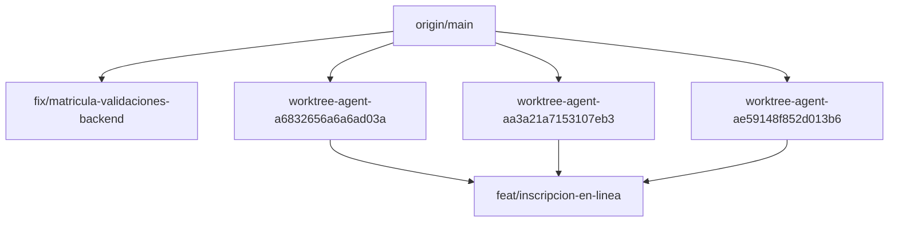

# P01 · inventario, auditoría y plan de pull requests

Estado: NO se publicó ninguna rama en P01. La publicación espera tu revisión de los candidatos de datos personales (d) y, en backend, de las coincidencias (b). No se modificaron archivos fuente, mensajes, autores, remotos ni historia. No se crearon commits, etiquetas ni PR; no se ejecutaron pruebas, builds, servidores ni SQL.

Repositorio: `/Users/lapcf051/Documents/UNI/coloradosdrive/coloradosdrive-backend`. Rama conservada: `feat/inscripcion-en-linea`; HEAD `162b1f757b91f97dfd2066317808eb3bf0082a6b`.
Inventario basado en refs locales origin/*, sin fetch ni consulta de red en P01. No se afirma que reflejen cambios remotos posteriores al último fetch. Antes de cualquier publicación se debe actualizar y comprobar las refs; si hay rechazo o historia distinta, detenerse sin forzar.

## Remoto y autores

```text
origin	https://github.com/ErickG11/coloradosdrive-backend.git (fetch)
origin	https://github.com/ErickG11/coloradosdrive-backend.git (push)
```
El propietario configurado es ErickG11 y el nombre coincide con el repositorio esperado; no apunta al namespace de otro usuario. Esto verifica la configuración local, no consulta el estado de fork en GitHub.

Autores distintos de los commits revisados (sin cambios):

- ErickG11 <grandaerick8@gmail.com>

Stashes: ninguno en ambos repos. El árbol tracked estaba limpio y se conserva. Los archivos sin seguimiento de progreso, deuda, contratos y .claude permanecen sin seguimiento; este plan también.

## Todas las ramas locales

| Rama | Upstream | Sobre origin/main | Solo local frente a upstream | Faltan en origin/misma-rama | Detrás de origin/main |
| --- | --- | ---: | ---: | ---: | ---: |
| `ci/circleci-pipeline` | `origin/ci/circleci-pipeline` | 0 | 0 | 0 | 1 |
| `feat/cohortes-eliminar-backend` | `origin/feat/cohortes-eliminar-backend` | 0 | 0 | 0 | 28 |
| `feat/inscripcion-en-linea` | `sin upstream` | 117 | 117 | 117 | 3 |
| `fix/cohortes-concurrencia-backend` | `origin/fix/cohortes-concurrencia-backend` | 0 | 0 | 0 | 33 |
| `fix/cohortes-validacion-servidor` | `origin/fix/cohortes-validacion-servidor` | 0 | 0 | 0 | 38 |
| `fix/matricula-validaciones-backend` | `origin/main` | 6 | 6 | 6 | 25 |
| `main` | `origin/main` | 0 | 0 | 0 | 0 |
| `worktree-agent-a6832656a6a6ad03a` | `sin upstream` | 67 | 67 | 67 | 3 |
| `worktree-agent-aa3a21a7153107eb3` | `sin upstream` | 73 | 73 | 73 | 3 |
| `worktree-agent-ae59148f852d013b6` | `sin upstream` | 68 | 68 | 68 | 3 |

Fusionadas/ancestros de origin/main, omitidas de publicación: `ci/circleci-pipeline`, `feat/cohortes-eliminar-backend`, `fix/cohortes-concurrencia-backend`, `fix/cohortes-validacion-servidor`, `main`.
Los conteos no se suman: varias ramas comparten commits. Los checkpoints de worktree son ramas locales reales; no se borran ni se renombran. Las ramas con cero commits frente a su remoto ya están publicadas y no se vuelven a empujar.

## Ancestros, puntas y orden

Relaciones comprobadas con merge-base; no se inventa una cadena lineal entre ramas divergentes.



Puntas independientes: `fix/matricula-validaciones-backend`, `feat/inscripcion-en-linea`.
La punta consolidada de inscripción contiene los checkpoints correspondientes; sus PR intermedios comparten mucha historia. Si se abren por separado sobre main, se solaparán: revisar los diffs y el orden antes de fusionar. P01 no fusiona ni resuelve divergencias.

Orden de publicación propuesto (solo tras desbloqueo):

1. `fix/matricula-validaciones-backend`
2. `worktree-agent-a6832656a6a6ad03a`
3. `worktree-agent-ae59148f852d013b6`
4. `worktree-agent-aa3a21a7153107eb3`
5. `feat/inscripcion-en-linea`

Backend completo primero; frontend después. Las líneas independientes pueden revisarse por separado; todos los ancestros nombrados van antes de sus descendientes.

## Resultado de los escaneos

Se revisaron 123 commits únicos y 33483 líneas añadidas, incluyendo commits intermedios y cambios luego retirados; 606 rutas en git ls-files del checkout actual, árboles de cada rama pendiente y blobs de todo el historial nuevo.

a) Mensajes: 0 coincidencias de Co-Authored-By, Claude, Codex, GPT, Generated with, IA/AI o equivalentes. No se modificaron mensajes.
b) Secretos: 11 coincidencias para revisión. JWT, sb_secret/sk_, AKIA, PRIVATE KEY, credenciales de conexión y asignaciones de contraseña/secreto se buscaron en las adiciones de cada commit, no solo en el diff final.
c) Rutas prohibidas trackeadas: 0; rutas intermedias prohibidas: 0; archivos actuales >5 MB (5.000.000 bytes): 0; blobs históricos nuevos >5 MB (5.000.000 bytes): 0. .env.example y plantillas equivalentes se separan como ejemplos, con valores revisados por b).
No se encontraron credenciales reales verificadas; esto no es una garantía de ausencia de secretos. Las coincidencias b) no se descartan automáticamente por estar en tests o documentación. Los nombres service_role de roles SQL no son claves: 245 referencias añadidas revisadas como identificadores de rol, además de buscar tokens y valores de claves.

### b) Coincidencias, sin reproducir posibles secretos

| Commit | Archivo:línea del commit | Patrón | Revisión de contexto |
| --- | --- | --- | --- |
| `d12d965` | `docs/operations/inscripcion-en-linea.md:30` | Secreto env con valor | ejemplo expresamente rotulado ficticio; valor no vacío |
| `d12d965` | `docs/operations/inscripcion-en-linea.md:32` | Secreto env con valor | ejemplo expresamente rotulado ficticio; valor no vacío |
| `c1a7e59` | `tests/unit/enrollmentConfig.test.ts:4` | Contraseña/secreto literal | literal de prueba o prueba de longitud; requiere clasificación manual |
| `c1a7e59` | `tests/unit/enrollmentConfig.test.ts:48` | Contraseña/secreto literal | literal de prueba o prueba de longitud; requiere clasificación manual |
| `321ff86` | `tests/unit/enrollmentLimits.test.ts:7` | Contraseña/secreto literal | literal de prueba o prueba de longitud; requiere clasificación manual |
| `321ff86` | `tests/unit/enrollmentLimits.test.ts:91` | Contraseña/secreto literal | literal de prueba o prueba de longitud; requiere clasificación manual |
| `09d34ea` | `tests/integration/solicitudCertificado.test.ts:190` | JWT literal | fixture JWT; no se presume credencial válida ni se reproduce |
| `03decec` | `src/scripts/securityRoutesEnv.ts:7` | Contraseña/secreto literal | script de inventario de seguridad; confirmar valores ficticios y uso |
| `03decec` | `src/scripts/securityRoutesEnv.ts:9` | Contraseña/secreto literal | script de inventario de seguridad; confirmar valores ficticios y uso |
| `ffc8a1d` | `src/scripts/securityRoutesEnv.ts:7` | Contraseña/secreto literal | script de inventario de seguridad; confirmar valores ficticios y uso |
| `ffc8a1d` | `src/scripts/securityRoutesEnv.ts:9` | Contraseña/secreto literal | script de inventario de seguridad; confirmar valores ficticios y uso |

### Cobertura real de exclusiones

Comprobación git check-ignore --no-index -v en la rama conservada. También se leyó .gitignore en cada rama local; las instantáneas más antiguas pueden tener menos reglas. No se añadió ninguna exclusión ni se afirmó cobertura donde falta. Gitignore no puede excluir genéricamente por tamaño.

| Ruta de control | Resultado/fuente |
| --- | --- |
| `.env` | .gitignore:5:.env	.env |
| `.env.local` | .gitignore:6:.env.local	.env.local |
| `keys/private.pem` | NO CUBIERTO |
| `keys/private.key` | NO CUBIERTO |
| `.auth/admin.json` | NO CUBIERTO |
| `storageState.json` | NO CUBIERTO |
| `node_modules/x` | .gitignore:2:node_modules/	node_modules/x |
| `.next/x` | NO CUBIERTO |
| `coverage/x` | .gitignore:14:coverage/	coverage/x |
| `playwright-report/x` | NO CUBIERTO |
| `test-results/x` | NO CUBIERTO |
| `.agents/x` | NO CUBIERTO |
| `.codex/x` | NO CUBIERTO |
| `.claude/x` | NO CUBIERTO |
| `.impeccable/x` | NO CUBIERTO |
| `.taste-skill/x` | NO CUBIERTO |
| `.github/skills/x` | NO CUBIERTO |
| `.github/agents/x` | NO CUBIERTO |
| `.github/hooks/x` | NO CUBIERTO |

### d) Candidatos de datos personales

Se informa una detección heurística, no se afirma que los ejemplos sean identidades reales. Incluye cédulas posibles (con/sin checksum), teléfonos09, correos en dominios enrutables y nombres en campos/literales/prosa. Hay falsos positivos de textos UI, cursos, instituciones, timestamps y plantillas; quedan identificados para tu decisión. Los ejemplos no se borraron ni censuraron en sus fuentes. Se separa árbol final e historial para no ocultar datos retirados de una punta pero conservados en commits públicos.
No se empuja ninguna rama pendiente hasta tu decisión sobre d), incluso si un dato parece ficticio o ya estaba en main.

| Rama | a mensajes | b coincidencias | c track/objetos | d árbol final | d historial añadido | Publicación P01 |
| --- | ---: | ---: | ---: | ---: | ---: | --- |
| `fix/matricula-validaciones-backend` | 0 | 0 | 0 | 170 | 17 | No: d pendiente |
| `worktree-agent-a6832656a6a6ad03a` | 0 | 9 | 0 | 225 | 102 | No: b/d pendientes |
| `worktree-agent-ae59148f852d013b6` | 0 | 7 | 0 | 225 | 102 | No: b/d pendientes |
| `worktree-agent-aa3a21a7153107eb3` | 0 | 7 | 0 | 225 | 102 | No: b/d pendientes |
| `feat/inscripcion-en-linea` | 0 | 11 | 0 | 229 | 106 | No: b/d pendientes |

## Hallazgos d en árboles finales · listado completo

286 posiciones/valores/versiones agrupadas; las ramas compartidas se enumeran. Commit es la procedencia de la línea según git blame, no un nuevo commit de P01.

| Archivo:línea | Tipo y valor | Commit de línea | Clasificación provisional | Ramas |
| --- | --- | --- | --- | --- |
| `docs/operations/inscripcion-042-verificacion.sql:25` | Correo de dominio real: `A.B+prueba@googlemail.com` | `83fb6ab` | dominio enrutable; real/ficticio/propiedad por confirmar | `feat/inscripcion-en-linea`, `worktree-agent-a6832656a6a6ad03a`, `worktree-agent-aa3a21a7153107eb3`, `worktree-agent-ae59148f852d013b6` |
| `docs/operations/inscripcion-042-verificacion.sql:25` | Correo de dominio real: `ab@gmail.com` | `83fb6ab` | dominio enrutable; real/ficticio/propiedad por confirmar | `feat/inscripcion-en-linea`, `worktree-agent-a6832656a6a6ad03a`, `worktree-agent-aa3a21a7153107eb3`, `worktree-agent-ae59148f852d013b6` |
| `docs/operations/inscripcion-063-verificacion.sql:11` | 10dígitos: `1710034065`; checksum EC válido | `72de7a6` | secuencia de 10 dígitos; no presupone identidad real | `feat/inscripcion-en-linea` |
| `docs/operations/inscripcion-063-verificacion.sql:11` | Nombre completo candidato: `María José` | `72de7a6` | nombre candidato; fixture/identidad real por confirmar | `feat/inscripcion-en-linea` |
| `docs/operations/inscripcion-063-verificacion.sql:14` | 10dígitos: `0223456789` | `72de7a6` | secuencia de 10 dígitos; no presupone identidad real | `feat/inscripcion-en-linea` |
| `docs/operations/inscripcion-063-verificacion.sql:16` | Teléfono09: `0991234567` | `72de7a6` | teléfono con forma ecuatoriana; ejemplo/propiedad por confirmar | `feat/inscripcion-en-linea` |
| `package-lock.json:3839` | Correo de dominio real: `i@izs.me` | `6d3f7a3` | dominio enrutable; real/ficticio/propiedad por confirmar | `fix/matricula-validaciones-backend` |
| `package-lock.json:4392` | Correo de dominio real: `i@izs.me` | `6d3f7a3` | dominio enrutable; real/ficticio/propiedad por confirmar | `feat/inscripcion-en-linea` |
| `package-lock.json:4407` | Correo de dominio real: `i@izs.me` | `6d3f7a3` | dominio enrutable; real/ficticio/propiedad por confirmar | `worktree-agent-a6832656a6a6ad03a`, `worktree-agent-aa3a21a7153107eb3`, `worktree-agent-ae59148f852d013b6` |
| `src/services/notificationEmail.service.ts:45` | Correo de dominio real: `notification.id}@notifications.coloradosdrive` | `2513743` | expresión de plantilla; no es una dirección literal completa | `feat/inscripcion-en-linea`, `worktree-agent-a6832656a6a6ad03a`, `worktree-agent-aa3a21a7153107eb3`, `worktree-agent-ae59148f852d013b6` |
| `src/utils/manualEnrollmentRules.ts:12` | Nombre en campo: `El nombre completo debe incluir letras y no puede contener números.` | `31508a5` | nombre candidato; fixture/identidad real por confirmar | `fix/matricula-validaciones-backend` |
| `tests/database/cohortConcurrency.mjs:77` | 10dígitos: `0000000001` | `9a4fa9e` | secuencia de 10 dígitos; no presupone identidad real | `feat/inscripcion-en-linea`, `fix/matricula-validaciones-backend`, `worktree-agent-a6832656a6a6ad03a`, `worktree-agent-aa3a21a7153107eb3`, `worktree-agent-ae59148f852d013b6` |
| `tests/database/studentCohort.mjs:153` | 10dígitos: `0000000005` | `73ff9a2` | secuencia de 10 dígitos; no presupone identidad real | `feat/inscripcion-en-linea`, `fix/matricula-validaciones-backend`, `worktree-agent-a6832656a6a6ad03a`, `worktree-agent-aa3a21a7153107eb3`, `worktree-agent-ae59148f852d013b6` |
| `tests/database/studentCohort.mjs:195` | 10dígitos: `0000000002` | `73ff9a2` | secuencia de 10 dígitos; no presupone identidad real | `feat/inscripcion-en-linea`, `fix/matricula-validaciones-backend`, `worktree-agent-a6832656a6a6ad03a`, `worktree-agent-aa3a21a7153107eb3`, `worktree-agent-ae59148f852d013b6` |
| `tests/database/studentDeletion.mjs:17` | 10dígitos: `0000000002` | `540961a` | secuencia de 10 dígitos; no presupone identidad real | `feat/inscripcion-en-linea`, `fix/matricula-validaciones-backend`, `worktree-agent-a6832656a6a6ad03a`, `worktree-agent-aa3a21a7153107eb3`, `worktree-agent-ae59148f852d013b6` |
| `tests/database/studentDeletion.mjs:99` | 10dígitos: `0000000002` | `540961a` | secuencia de 10 dígitos; no presupone identidad real | `fix/matricula-validaciones-backend` |
| `tests/database/studentDeletion.mjs:102` | 10dígitos: `0000000002` | `540961a` | secuencia de 10 dígitos; no presupone identidad real | `feat/inscripcion-en-linea`, `worktree-agent-a6832656a6a6ad03a`, `worktree-agent-aa3a21a7153107eb3`, `worktree-agent-ae59148f852d013b6` |
| `tests/database/studentDeletion.mjs:136` | 10dígitos: `0000000000` | `540961a` | secuencia de 10 dígitos; no presupone identidad real | `fix/matricula-validaciones-backend` |
| `tests/database/studentDeletion.mjs:139` | 10dígitos: `0000000000` | `540961a` | secuencia de 10 dígitos; no presupone identidad real | `feat/inscripcion-en-linea`, `worktree-agent-a6832656a6a6ad03a`, `worktree-agent-aa3a21a7153107eb3`, `worktree-agent-ae59148f852d013b6` |
| `tests/database/studentDeletion.mjs:139` | 10dígitos: `0000000004` | `540961a` | secuencia de 10 dígitos; no presupone identidad real | `fix/matricula-validaciones-backend` |
| `tests/database/studentDeletion.mjs:140` | 10dígitos: `0000000002` | `540961a` | secuencia de 10 dígitos; no presupone identidad real | `fix/matricula-validaciones-backend` |
| `tests/database/studentDeletion.mjs:142` | 10dígitos: `0000000004` | `540961a` | secuencia de 10 dígitos; no presupone identidad real | `feat/inscripcion-en-linea`, `worktree-agent-a6832656a6a6ad03a`, `worktree-agent-aa3a21a7153107eb3`, `worktree-agent-ae59148f852d013b6` |
| `tests/database/studentDeletion.mjs:143` | 10dígitos: `0000000002` | `540961a` | secuencia de 10 dígitos; no presupone identidad real | `feat/inscripcion-en-linea`, `worktree-agent-a6832656a6a6ad03a`, `worktree-agent-aa3a21a7153107eb3`, `worktree-agent-ae59148f852d013b6` |
| `tests/database/studentDeletion.mjs:270` | 10dígitos: `0000000006` | `540961a` | secuencia de 10 dígitos; no presupone identidad real | `fix/matricula-validaciones-backend` |
| `tests/database/studentDeletion.mjs:277` | 10dígitos: `0000000006` | `540961a` | secuencia de 10 dígitos; no presupone identidad real | `feat/inscripcion-en-linea`, `worktree-agent-a6832656a6a6ad03a`, `worktree-agent-aa3a21a7153107eb3`, `worktree-agent-ae59148f852d013b6` |
| `tests/database/studentProfile.mjs:44` | 10dígitos: `0000000001` | `61cbf8a` | secuencia de 10 dígitos; no presupone identidad real | `feat/inscripcion-en-linea`, `fix/matricula-validaciones-backend`, `worktree-agent-a6832656a6a6ad03a`, `worktree-agent-aa3a21a7153107eb3`, `worktree-agent-ae59148f852d013b6` |
| `tests/database/studentProfile.mjs:45` | 10dígitos: `1710034065`; checksum EC válido | `61cbf8a` | secuencia de 10 dígitos; no presupone identidad real | `feat/inscripcion-en-linea`, `fix/matricula-validaciones-backend`, `worktree-agent-a6832656a6a6ad03a`, `worktree-agent-aa3a21a7153107eb3`, `worktree-agent-ae59148f852d013b6` |
| `tests/database/studentProfile.mjs:46` | 10dígitos: `0000000003` | `61cbf8a` | secuencia de 10 dígitos; no presupone identidad real | `feat/inscripcion-en-linea`, `fix/matricula-validaciones-backend`, `worktree-agent-a6832656a6a6ad03a`, `worktree-agent-aa3a21a7153107eb3`, `worktree-agent-ae59148f852d013b6` |
| `tests/database/studentProfile.mjs:100` | 10dígitos: `0000000003` | `61cbf8a` | secuencia de 10 dígitos; no presupone identidad real | `feat/inscripcion-en-linea`, `fix/matricula-validaciones-backend`, `worktree-agent-a6832656a6a6ad03a`, `worktree-agent-aa3a21a7153107eb3`, `worktree-agent-ae59148f852d013b6` |
| `tests/database/studentProfile.mjs:100` | Nombre en campo: `No guardar` | `61cbf8a` | nombre candidato; fixture/identidad real por confirmar | `feat/inscripcion-en-linea`, `fix/matricula-validaciones-backend`, `worktree-agent-a6832656a6a6ad03a`, `worktree-agent-aa3a21a7153107eb3`, `worktree-agent-ae59148f852d013b6` |
| `tests/database/studentProfile.mjs:110` | Nombre en campo: `No guardar` | `61cbf8a` | nombre candidato; fixture/identidad real por confirmar | `feat/inscripcion-en-linea`, `fix/matricula-validaciones-backend`, `worktree-agent-a6832656a6a6ad03a`, `worktree-agent-aa3a21a7153107eb3`, `worktree-agent-ae59148f852d013b6` |
| `tests/database/students.mjs:194` | Nombre completo candidato: `José Álvarez` | `b73ba7f` | nombre candidato; fixture/identidad real por confirmar | `feat/inscripcion-en-linea`, `fix/matricula-validaciones-backend`, `worktree-agent-a6832656a6a6ad03a`, `worktree-agent-aa3a21a7153107eb3`, `worktree-agent-ae59148f852d013b6` |
| `tests/database/students.mjs:199` | 10dígitos: `0000000002` | `b73ba7f` | secuencia de 10 dígitos; no presupone identidad real | `feat/inscripcion-en-linea`, `fix/matricula-validaciones-backend`, `worktree-agent-a6832656a6a6ad03a`, `worktree-agent-aa3a21a7153107eb3`, `worktree-agent-ae59148f852d013b6` |
| `tests/database/students.mjs:288` | 10dígitos: `0000000007` | `f132c73` | secuencia de 10 dígitos; no presupone identidad real | `feat/inscripcion-en-linea`, `fix/matricula-validaciones-backend`, `worktree-agent-a6832656a6a6ad03a`, `worktree-agent-aa3a21a7153107eb3`, `worktree-agent-ae59148f852d013b6` |
| `tests/integration/cohortAssignmentPreview.test.ts:31` | Nombre en campo: `Cohorte Marzo` | `10e867f` | posible texto de UI/institución/curso; no se afirma nombre personal | `feat/inscripcion-en-linea`, `fix/matricula-validaciones-backend`, `worktree-agent-a6832656a6a6ad03a`, `worktree-agent-aa3a21a7153107eb3`, `worktree-agent-ae59148f852d013b6` |
| `tests/integration/cohorts.test.ts:29` | Nombre en campo: `Cohorte Marzo 2026` | `8e2b76e` | posible texto de UI/institución/curso; no se afirma nombre personal | `feat/inscripcion-en-linea`, `fix/matricula-validaciones-backend`, `worktree-agent-a6832656a6a6ad03a`, `worktree-agent-aa3a21a7153107eb3`, `worktree-agent-ae59148f852d013b6` |
| `tests/integration/cohorts.test.ts:77` | Nombre en campo: `Nuevo nombre` | `8e2b76e` | nombre candidato; fixture/identidad real por confirmar | `feat/inscripcion-en-linea`, `fix/matricula-validaciones-backend`, `worktree-agent-a6832656a6a6ad03a`, `worktree-agent-aa3a21a7153107eb3`, `worktree-agent-ae59148f852d013b6` |
| `tests/integration/cohorts.test.ts:224` | 10dígitos: `3000000000` | `0aa78c2` | secuencia de 10 dígitos; no presupone identidad real | `feat/inscripcion-en-linea`, `fix/matricula-validaciones-backend`, `worktree-agent-a6832656a6a6ad03a`, `worktree-agent-aa3a21a7153107eb3`, `worktree-agent-ae59148f852d013b6` |
| `tests/integration/cohorts.test.ts:378` | Nombre en campo: `  Cohorte Marzo 2026  ` | `0aa78c2` | nombre candidato; fixture/identidad real por confirmar | `feat/inscripcion-en-linea`, `fix/matricula-validaciones-backend`, `worktree-agent-a6832656a6a6ad03a`, `worktree-agent-aa3a21a7153107eb3`, `worktree-agent-ae59148f852d013b6` |
| `tests/integration/cohorts.test.ts:386` | Nombre en campo: `Cohorte Marzo 2026` | `0aa78c2` | posible texto de UI/institución/curso; no se afirma nombre personal | `feat/inscripcion-en-linea`, `fix/matricula-validaciones-backend`, `worktree-agent-a6832656a6a6ad03a`, `worktree-agent-aa3a21a7153107eb3`, `worktree-agent-ae59148f852d013b6` |
| `tests/integration/cohorts.test.ts:397` | Nombre en campo: `  COHORTE marzo 2026 ` | `0aa78c2` | nombre candidato; fixture/identidad real por confirmar | `feat/inscripcion-en-linea`, `fix/matricula-validaciones-backend`, `worktree-agent-a6832656a6a6ad03a`, `worktree-agent-aa3a21a7153107eb3`, `worktree-agent-ae59148f852d013b6` |
| `tests/integration/cohorts.test.ts:628` | Nombre en campo: `Cohorte Abril` | `0aa78c2` | posible texto de UI/institución/curso; no se afirma nombre personal | `feat/inscripcion-en-linea`, `fix/matricula-validaciones-backend`, `worktree-agent-a6832656a6a6ad03a`, `worktree-agent-aa3a21a7153107eb3`, `worktree-agent-ae59148f852d013b6` |
| `tests/integration/cohorts.test.ts:635` | Nombre en campo: ` cohorte abril ` | `0aa78c2` | nombre candidato; fixture/identidad real por confirmar | `feat/inscripcion-en-linea`, `fix/matricula-validaciones-backend`, `worktree-agent-a6832656a6a6ad03a`, `worktree-agent-aa3a21a7153107eb3`, `worktree-agent-ae59148f852d013b6` |
| `tests/integration/cohorts.test.ts:856` | Nombre en campo: `Cohorte Abril` | `9a8400d` | posible texto de UI/institución/curso; no se afirma nombre personal | `feat/inscripcion-en-linea`, `fix/matricula-validaciones-backend`, `worktree-agent-a6832656a6a6ad03a`, `worktree-agent-aa3a21a7153107eb3`, `worktree-agent-ae59148f852d013b6` |
| `tests/integration/cohorts.test.ts:862` | Nombre en campo: `Cohorte Abril` | `9a8400d` | posible texto de UI/institución/curso; no se afirma nombre personal | `feat/inscripcion-en-linea`, `fix/matricula-validaciones-backend`, `worktree-agent-a6832656a6a6ad03a`, `worktree-agent-aa3a21a7153107eb3`, `worktree-agent-ae59148f852d013b6` |
| `tests/integration/cohorts.test.ts:866` | Nombre en campo: `Cohorte Abril` | `9a8400d` | posible texto de UI/institución/curso; no se afirma nombre personal | `feat/inscripcion-en-linea`, `fix/matricula-validaciones-backend`, `worktree-agent-a6832656a6a6ad03a`, `worktree-agent-aa3a21a7153107eb3`, `worktree-agent-ae59148f852d013b6` |
| `tests/integration/cohorts.test.ts:870` | Nombre en campo: `Cohorte Abril` | `9a8400d` | posible texto de UI/institución/curso; no se afirma nombre personal | `feat/inscripcion-en-linea`, `fix/matricula-validaciones-backend`, `worktree-agent-a6832656a6a6ad03a`, `worktree-agent-aa3a21a7153107eb3`, `worktree-agent-ae59148f852d013b6` |
| `tests/integration/cohorts.test.ts:1117` | Nombre en campo: `Cohorte Marzo 2026` | `51d1136` | posible texto de UI/institución/curso; no se afirma nombre personal | `feat/inscripcion-en-linea`, `fix/matricula-validaciones-backend`, `worktree-agent-a6832656a6a6ad03a`, `worktree-agent-aa3a21a7153107eb3`, `worktree-agent-ae59148f852d013b6` |
| `tests/integration/cohorts.test.ts:1310` | Nombre en campo: `Matrícula Única` | `aebd09f` | nombre candidato; fixture/identidad real por confirmar | `feat/inscripcion-en-linea`, `fix/matricula-validaciones-backend`, `worktree-agent-a6832656a6a6ad03a`, `worktree-agent-aa3a21a7153107eb3`, `worktree-agent-ae59148f852d013b6` |
| `tests/integration/cohorts.test.ts:1354` | Nombre en campo: `Cohorte Marzo 2026` | `51d1136` | posible texto de UI/institución/curso; no se afirma nombre personal | `feat/inscripcion-en-linea`, `fix/matricula-validaciones-backend`, `worktree-agent-a6832656a6a6ad03a`, `worktree-agent-aa3a21a7153107eb3`, `worktree-agent-ae59148f852d013b6` |
| `tests/integration/consoleEmail.test.ts:86` | 10dígitos: `1710034065`; checksum EC válido | `d12d965` | secuencia de 10 dígitos; no presupone identidad real | `feat/inscripcion-en-linea`, `worktree-agent-a6832656a6a6ad03a`, `worktree-agent-aa3a21a7153107eb3`, `worktree-agent-ae59148f852d013b6` |
| `tests/integration/consoleEmail.test.ts:87` | Nombre en campo: `Persona Ficticia` | `d12d965` | nombre candidato; fixture/identidad real por confirmar | `feat/inscripcion-en-linea`, `worktree-agent-a6832656a6a6ad03a`, `worktree-agent-aa3a21a7153107eb3`, `worktree-agent-ae59148f852d013b6` |
| `tests/integration/consoleEmail.test.ts:147` | Nombre en campo: `Persona Ficticia` | `d12d965` | nombre candidato; fixture/identidad real por confirmar | `feat/inscripcion-en-linea`, `worktree-agent-a6832656a6a6ad03a`, `worktree-agent-aa3a21a7153107eb3`, `worktree-agent-ae59148f852d013b6` |
| `tests/integration/enrollments.test.ts:34` | 10dígitos: `1234567890` | `8e2b76e` | secuencia de 10 dígitos; no presupone identidad real | `feat/inscripcion-en-linea`, `fix/matricula-validaciones-backend`, `worktree-agent-a6832656a6a6ad03a`, `worktree-agent-aa3a21a7153107eb3`, `worktree-agent-ae59148f852d013b6` |
| `tests/integration/enrollments.test.ts:35` | Nombre completo candidato: `Ana Torres` | `8e2b76e` | nombre candidato; fixture/identidad real por confirmar | `feat/inscripcion-en-linea`, `fix/matricula-validaciones-backend`, `worktree-agent-a6832656a6a6ad03a`, `worktree-agent-aa3a21a7153107eb3`, `worktree-agent-ae59148f852d013b6` |
| `tests/integration/enrollments.test.ts:35` | Nombre en campo: `Ana Torres` | `8e2b76e` | nombre candidato; fixture/identidad real por confirmar | `feat/inscripcion-en-linea`, `fix/matricula-validaciones-backend`, `worktree-agent-a6832656a6a6ad03a`, `worktree-agent-aa3a21a7153107eb3`, `worktree-agent-ae59148f852d013b6` |
| `tests/integration/enrollments.test.ts:37` | Teléfono09: `0999999999` | `8e2b76e` | teléfono con forma ecuatoriana; ejemplo/propiedad por confirmar | `feat/inscripcion-en-linea`, `fix/matricula-validaciones-backend`, `worktree-agent-a6832656a6a6ad03a`, `worktree-agent-aa3a21a7153107eb3`, `worktree-agent-ae59148f852d013b6` |
| `tests/integration/enrollments.test.ts:44` | Nombre en campo: `Cohorte Marzo` | `8e2b76e` | posible texto de UI/institución/curso; no se afirma nombre personal | `feat/inscripcion-en-linea`, `fix/matricula-validaciones-backend`, `worktree-agent-a6832656a6a6ad03a`, `worktree-agent-aa3a21a7153107eb3`, `worktree-agent-ae59148f852d013b6` |
| `tests/integration/enrollments.test.ts:337` | 10dígitos: `1234567890` | `bc0037f` | secuencia de 10 dígitos; no presupone identidad real | `feat/inscripcion-en-linea`, `worktree-agent-a6832656a6a6ad03a`, `worktree-agent-aa3a21a7153107eb3`, `worktree-agent-ae59148f852d013b6` |
| `tests/integration/enrollments.test.ts:338` | Nombre completo candidato: `Ana Torres` | `bc0037f` | nombre candidato; fixture/identidad real por confirmar | `feat/inscripcion-en-linea`, `worktree-agent-a6832656a6a6ad03a`, `worktree-agent-aa3a21a7153107eb3`, `worktree-agent-ae59148f852d013b6` |
| `tests/integration/enrollments.test.ts:338` | Nombre en campo: `Ana Torres` | `bc0037f` | nombre candidato; fixture/identidad real por confirmar | `feat/inscripcion-en-linea`, `worktree-agent-a6832656a6a6ad03a`, `worktree-agent-aa3a21a7153107eb3`, `worktree-agent-ae59148f852d013b6` |
| `tests/integration/enrollments.test.ts:340` | Teléfono09: `0999999999` | `bc0037f` | teléfono con forma ecuatoriana; ejemplo/propiedad por confirmar | `feat/inscripcion-en-linea`, `worktree-agent-a6832656a6a6ad03a`, `worktree-agent-aa3a21a7153107eb3`, `worktree-agent-ae59148f852d013b6` |
| `tests/integration/enrollments.test.ts:352` | 10dígitos: `1234567890` | `bc0037f` | secuencia de 10 dígitos; no presupone identidad real | `fix/matricula-validaciones-backend` |
| `tests/integration/enrollments.test.ts:353` | Nombre completo candidato: `Ana Torres` | `bc0037f` | nombre candidato; fixture/identidad real por confirmar | `fix/matricula-validaciones-backend` |
| `tests/integration/enrollments.test.ts:353` | Nombre en campo: `Ana Torres` | `bc0037f` | nombre candidato; fixture/identidad real por confirmar | `fix/matricula-validaciones-backend` |
| `tests/integration/enrollments.test.ts:355` | Teléfono09: `0999999999` | `bc0037f` | teléfono con forma ecuatoriana; ejemplo/propiedad por confirmar | `fix/matricula-validaciones-backend` |
| `tests/integration/examAttempts.test.ts:394` | Nombre completo candidato: `Ana Torres` | `1888d39` | nombre candidato; fixture/identidad real por confirmar | `feat/inscripcion-en-linea`, `fix/matricula-validaciones-backend`, `worktree-agent-a6832656a6a6ad03a`, `worktree-agent-aa3a21a7153107eb3`, `worktree-agent-ae59148f852d013b6` |
| `tests/integration/examAttempts.test.ts:394` | Nombre en campo: `Ana Torres` | `1888d39` | nombre candidato; fixture/identidad real por confirmar | `feat/inscripcion-en-linea`, `fix/matricula-validaciones-backend`, `worktree-agent-a6832656a6a6ad03a`, `worktree-agent-aa3a21a7153107eb3`, `worktree-agent-ae59148f852d013b6` |
| `tests/integration/instructors.test.ts:31` | 10dígitos: `1710034065`; checksum EC válido | `b600152` | secuencia de 10 dígitos; no presupone identidad real | `feat/inscripcion-en-linea`, `fix/matricula-validaciones-backend`, `worktree-agent-a6832656a6a6ad03a`, `worktree-agent-aa3a21a7153107eb3`, `worktree-agent-ae59148f852d013b6` |
| `tests/integration/instructors.test.ts:31` | Nombre completo candidato: `Ana Torres` | `b600152` | nombre candidato; fixture/identidad real por confirmar | `feat/inscripcion-en-linea`, `fix/matricula-validaciones-backend`, `worktree-agent-a6832656a6a6ad03a`, `worktree-agent-aa3a21a7153107eb3`, `worktree-agent-ae59148f852d013b6` |
| `tests/integration/instructors.test.ts:31` | Nombre en campo: `Ana Torres` | `b600152` | nombre candidato; fixture/identidad real por confirmar | `feat/inscripcion-en-linea`, `fix/matricula-validaciones-backend`, `worktree-agent-a6832656a6a6ad03a`, `worktree-agent-aa3a21a7153107eb3`, `worktree-agent-ae59148f852d013b6` |
| `tests/integration/instructors.test.ts:32` | Teléfono09: `0991234567` | `b600152` | teléfono con forma ecuatoriana; ejemplo/propiedad por confirmar | `feat/inscripcion-en-linea`, `fix/matricula-validaciones-backend`, `worktree-agent-a6832656a6a6ad03a`, `worktree-agent-aa3a21a7153107eb3`, `worktree-agent-ae59148f852d013b6` |
| `tests/integration/instructors.test.ts:76` | 10dígitos: `1710034064` | `b600152` | secuencia de 10 dígitos; no presupone identidad real | `feat/inscripcion-en-linea`, `fix/matricula-validaciones-backend`, `worktree-agent-a6832656a6a6ad03a`, `worktree-agent-aa3a21a7153107eb3`, `worktree-agent-ae59148f852d013b6` |
| `tests/integration/instructors.test.ts:152` | Nombre completo candidato: `Ana Rojas` | `b600152` | nombre candidato; fixture/identidad real por confirmar | `feat/inscripcion-en-linea`, `fix/matricula-validaciones-backend`, `worktree-agent-a6832656a6a6ad03a`, `worktree-agent-aa3a21a7153107eb3`, `worktree-agent-ae59148f852d013b6` |
| `tests/integration/instructors.test.ts:152` | Nombre en campo: `Ana Rojas` | `b600152` | nombre candidato; fixture/identidad real por confirmar | `feat/inscripcion-en-linea`, `fix/matricula-validaciones-backend`, `worktree-agent-a6832656a6a6ad03a`, `worktree-agent-aa3a21a7153107eb3`, `worktree-agent-ae59148f852d013b6` |
| `tests/integration/instructors.test.ts:156` | Nombre completo candidato: `Ana Rojas` | `b600152` | nombre candidato; fixture/identidad real por confirmar | `feat/inscripcion-en-linea`, `fix/matricula-validaciones-backend`, `worktree-agent-a6832656a6a6ad03a`, `worktree-agent-aa3a21a7153107eb3`, `worktree-agent-ae59148f852d013b6` |
| `tests/integration/instructors.test.ts:156` | Nombre en campo: `Ana Rojas` | `b600152` | nombre candidato; fixture/identidad real por confirmar | `feat/inscripcion-en-linea`, `fix/matricula-validaciones-backend`, `worktree-agent-a6832656a6a6ad03a`, `worktree-agent-aa3a21a7153107eb3`, `worktree-agent-ae59148f852d013b6` |
| `tests/integration/instructors.test.ts:159` | Nombre completo candidato: `Ana Rojas` | `b600152` | nombre candidato; fixture/identidad real por confirmar | `feat/inscripcion-en-linea`, `fix/matricula-validaciones-backend`, `worktree-agent-a6832656a6a6ad03a`, `worktree-agent-aa3a21a7153107eb3`, `worktree-agent-ae59148f852d013b6` |
| `tests/integration/instructors.test.ts:159` | Nombre en campo: `Ana Rojas` | `b600152` | nombre candidato; fixture/identidad real por confirmar | `feat/inscripcion-en-linea`, `fix/matricula-validaciones-backend`, `worktree-agent-a6832656a6a6ad03a`, `worktree-agent-aa3a21a7153107eb3`, `worktree-agent-ae59148f852d013b6` |
| `tests/integration/manualEnrollmentValidations.test.ts:33` | 10dígitos: `1710034065`; checksum EC válido | `31508a5` | secuencia de 10 dígitos; no presupone identidad real | `fix/matricula-validaciones-backend` |
| `tests/integration/manualEnrollmentValidations.test.ts:33` | Nombre completo candidato: `María José Pérez` | `31508a5` | nombre candidato; fixture/identidad real por confirmar | `fix/matricula-validaciones-backend` |
| `tests/integration/manualEnrollmentValidations.test.ts:33` | Nombre en campo: `María José Pérez` | `31508a5` | nombre candidato; fixture/identidad real por confirmar | `fix/matricula-validaciones-backend` |
| `tests/integration/manualEnrollmentValidations.test.ts:53` | 10dígitos: `1710034065`; checksum EC válido | `31508a5` | secuencia de 10 dígitos; no presupone identidad real | `fix/matricula-validaciones-backend` |
| `tests/integration/manualEnrollmentValidations.test.ts:57` | 10dígitos: `1710034065`; checksum EC válido | `31508a5` | secuencia de 10 dígitos; no presupone identidad real | `fix/matricula-validaciones-backend` |
| `tests/integration/manualEnrollmentValidations.test.ts:61` | 10dígitos: `1710034065`; checksum EC válido | `31508a5` | secuencia de 10 dígitos; no presupone identidad real | `fix/matricula-validaciones-backend` |
| `tests/integration/manualEnrollmentValidations.test.ts:67` | 10dígitos: `1710034065`; checksum EC válido | `31508a5` | secuencia de 10 dígitos; no presupone identidad real | `fix/matricula-validaciones-backend` |
| `tests/integration/manualEnrollmentValidations.test.ts:68` | Nombre en campo: `Nombre Secreto` | `31508a5` | nombre candidato; fixture/identidad real por confirmar | `fix/matricula-validaciones-backend` |
| `tests/integration/manualEnrollmentValidations.test.ts:70` | 10dígitos: `1710034065`; checksum EC válido | `31508a5` | secuencia de 10 dígitos; no presupone identidad real | `fix/matricula-validaciones-backend` |
| `tests/integration/manualEnrollmentValidations.test.ts:81` | 10dígitos: `1710034065`; checksum EC válido | `31508a5` | secuencia de 10 dígitos; no presupone identidad real | `fix/matricula-validaciones-backend` |
| `tests/integration/manualEnrollmentValidations.test.ts:94` | 10dígitos: `1710034065`; checksum EC válido | `2a3387f` | secuencia de 10 dígitos; no presupone identidad real | `fix/matricula-validaciones-backend` |
| `tests/integration/manualEnrollmentValidations.test.ts:103` | 10dígitos: `1234567890` | `31508a5` | secuencia de 10 dígitos; no presupone identidad real | `fix/matricula-validaciones-backend` |
| `tests/integration/manualEnrollmentValidations.test.ts:104` | 10dígitos: `1710034065`; checksum EC válido | `31508a5` | secuencia de 10 dígitos; no presupone identidad real | `fix/matricula-validaciones-backend` |
| `tests/integration/manualEnrollmentValidations.test.ts:122` | 10dígitos: `1710034066` | `31508a5` | secuencia de 10 dígitos; no presupone identidad real | `fix/matricula-validaciones-backend` |
| `tests/integration/manualEnrollmentValidations.test.ts:130` | Nombre en campo: `Ana 2` | `31508a5` | nombre candidato; fixture/identidad real por confirmar | `fix/matricula-validaciones-backend` |
| `tests/integration/practiceSlotActions.test.ts:167` | 10dígitos: `1234567890` | `8df062e` | secuencia de 10 dígitos; no presupone identidad real | `feat/inscripcion-en-linea`, `worktree-agent-a6832656a6a6ad03a`, `worktree-agent-aa3a21a7153107eb3`, `worktree-agent-ae59148f852d013b6` |
| `tests/integration/practiceSlotGeneration.test.ts:144` | Nombre en campo: `Bruno Salas` | `f4c921d` | nombre candidato; fixture/identidad real por confirmar | `feat/inscripcion-en-linea`, `worktree-agent-a6832656a6a6ad03a`, `worktree-agent-aa3a21a7153107eb3`, `worktree-agent-ae59148f852d013b6` |
| `tests/integration/practiceSlotGeneration.test.ts:160` | Nombre en campo: `Bruno Salas` | `8a0359d` | nombre candidato; fixture/identidad real por confirmar | `feat/inscripcion-en-linea`, `worktree-agent-a6832656a6a6ad03a`, `worktree-agent-aa3a21a7153107eb3`, `worktree-agent-ae59148f852d013b6` |
| `tests/integration/practiceSlotGeneration.test.ts:160` | Nombre en campo: `Bruno Salas` | `f4c921d` | nombre candidato; fixture/identidad real por confirmar | `fix/matricula-validaciones-backend` |
| `tests/integration/practiceSlotGeneration.test.ts:176` | Nombre en campo: `Bruno Salas` | `8a0359d` | nombre candidato; fixture/identidad real por confirmar | `fix/matricula-validaciones-backend` |
| `tests/integration/practiceSlotGeneration.test.ts:205` | Nombre en campo: `Bruno Salas` | `f4c921d` | nombre candidato; fixture/identidad real por confirmar | `feat/inscripcion-en-linea`, `worktree-agent-a6832656a6a6ad03a`, `worktree-agent-aa3a21a7153107eb3`, `worktree-agent-ae59148f852d013b6` |
| `tests/integration/practiceSlotGeneration.test.ts:221` | Nombre en campo: `Bruno Salas` | `f4c921d` | nombre candidato; fixture/identidad real por confirmar | `fix/matricula-validaciones-backend` |
| `tests/integration/practiceSlots.test.ts:59` | Nombre en campo: `Bruno Salas` | `b600152` | nombre candidato; fixture/identidad real por confirmar | `feat/inscripcion-en-linea`, `fix/matricula-validaciones-backend`, `worktree-agent-a6832656a6a6ad03a`, `worktree-agent-aa3a21a7153107eb3`, `worktree-agent-ae59148f852d013b6` |
| `tests/integration/practiceSlots.test.ts:180` | Nombre completo candidato: `Ana Torres` | `753f96c` | nombre candidato; fixture/identidad real por confirmar | `feat/inscripcion-en-linea`, `fix/matricula-validaciones-backend`, `worktree-agent-a6832656a6a6ad03a`, `worktree-agent-aa3a21a7153107eb3`, `worktree-agent-ae59148f852d013b6` |
| `tests/integration/practiceSlots.test.ts:180` | Nombre en campo: `Ana Torres` | `753f96c` | nombre candidato; fixture/identidad real por confirmar | `feat/inscripcion-en-linea`, `fix/matricula-validaciones-backend`, `worktree-agent-a6832656a6a6ad03a`, `worktree-agent-aa3a21a7153107eb3`, `worktree-agent-ae59148f852d013b6` |
| `tests/integration/practiceSlots.test.ts:191` | Nombre completo candidato: `Ana Torres` | `753f96c` | nombre candidato; fixture/identidad real por confirmar | `feat/inscripcion-en-linea`, `fix/matricula-validaciones-backend`, `worktree-agent-a6832656a6a6ad03a`, `worktree-agent-aa3a21a7153107eb3`, `worktree-agent-ae59148f852d013b6` |
| `tests/integration/practiceSlots.test.ts:191` | Nombre en campo: `Ana Torres` | `753f96c` | nombre candidato; fixture/identidad real por confirmar | `feat/inscripcion-en-linea`, `fix/matricula-validaciones-backend`, `worktree-agent-a6832656a6a6ad03a`, `worktree-agent-aa3a21a7153107eb3`, `worktree-agent-ae59148f852d013b6` |
| `tests/integration/practiceSlots.test.ts:264` | Nombre completo candidato: `Ana Torres` | `3531834` | nombre candidato; fixture/identidad real por confirmar | `feat/inscripcion-en-linea`, `fix/matricula-validaciones-backend`, `worktree-agent-a6832656a6a6ad03a`, `worktree-agent-aa3a21a7153107eb3`, `worktree-agent-ae59148f852d013b6` |
| `tests/integration/practiceSlots.test.ts:264` | Nombre en campo: `Ana Torres` | `3531834` | nombre candidato; fixture/identidad real por confirmar | `feat/inscripcion-en-linea`, `fix/matricula-validaciones-backend`, `worktree-agent-a6832656a6a6ad03a`, `worktree-agent-aa3a21a7153107eb3`, `worktree-agent-ae59148f852d013b6` |
| `tests/integration/practiceSlots.test.ts:293` | Nombre completo candidato: `Ana Torres` | `3531834` | nombre candidato; fixture/identidad real por confirmar | `feat/inscripcion-en-linea`, `fix/matricula-validaciones-backend`, `worktree-agent-a6832656a6a6ad03a`, `worktree-agent-aa3a21a7153107eb3`, `worktree-agent-ae59148f852d013b6` |
| `tests/integration/practiceSlots.test.ts:293` | Nombre en campo: `Ana Torres` | `3531834` | nombre candidato; fixture/identidad real por confirmar | `feat/inscripcion-en-linea`, `fix/matricula-validaciones-backend`, `worktree-agent-a6832656a6a6ad03a`, `worktree-agent-aa3a21a7153107eb3`, `worktree-agent-ae59148f852d013b6` |
| `tests/integration/practiceSlots.test.ts:337` | Nombre completo candidato: `Ana Torres` | `f5d3ab7` | nombre candidato; fixture/identidad real por confirmar | `feat/inscripcion-en-linea`, `fix/matricula-validaciones-backend`, `worktree-agent-a6832656a6a6ad03a`, `worktree-agent-aa3a21a7153107eb3`, `worktree-agent-ae59148f852d013b6` |
| `tests/integration/practiceSlots.test.ts:337` | Nombre en campo: `Ana Torres` | `f5d3ab7` | nombre candidato; fixture/identidad real por confirmar | `feat/inscripcion-en-linea`, `fix/matricula-validaciones-backend`, `worktree-agent-a6832656a6a6ad03a`, `worktree-agent-aa3a21a7153107eb3`, `worktree-agent-ae59148f852d013b6` |
| `tests/integration/practiceSlots.test.ts:356` | Nombre completo candidato: `Ana Torres` | `753f96c` | nombre candidato; fixture/identidad real por confirmar | `feat/inscripcion-en-linea`, `fix/matricula-validaciones-backend`, `worktree-agent-a6832656a6a6ad03a`, `worktree-agent-aa3a21a7153107eb3`, `worktree-agent-ae59148f852d013b6` |
| `tests/integration/practiceSlots.test.ts:356` | Nombre en campo: `Ana Torres` | `753f96c` | nombre candidato; fixture/identidad real por confirmar | `feat/inscripcion-en-linea`, `fix/matricula-validaciones-backend`, `worktree-agent-a6832656a6a6ad03a`, `worktree-agent-aa3a21a7153107eb3`, `worktree-agent-ae59148f852d013b6` |
| `tests/integration/practiceSlots.test.ts:400` | Nombre en campo: `Bruno Salas` | `f5d3ab7` | nombre candidato; fixture/identidad real por confirmar | `feat/inscripcion-en-linea`, `fix/matricula-validaciones-backend`, `worktree-agent-a6832656a6a6ad03a`, `worktree-agent-aa3a21a7153107eb3`, `worktree-agent-ae59148f852d013b6` |
| `tests/integration/practiceSlots.test.ts:450` | Nombre completo candidato: `Ana Torres` | `753f96c` | nombre candidato; fixture/identidad real por confirmar | `feat/inscripcion-en-linea`, `fix/matricula-validaciones-backend`, `worktree-agent-a6832656a6a6ad03a`, `worktree-agent-aa3a21a7153107eb3`, `worktree-agent-ae59148f852d013b6` |
| `tests/integration/practiceSlots.test.ts:450` | Nombre en campo: `Ana Torres` | `753f96c` | nombre candidato; fixture/identidad real por confirmar | `feat/inscripcion-en-linea`, `fix/matricula-validaciones-backend`, `worktree-agent-a6832656a6a6ad03a`, `worktree-agent-aa3a21a7153107eb3`, `worktree-agent-ae59148f852d013b6` |
| `tests/integration/practiceSlots.test.ts:464` | Nombre completo candidato: `Ana Torres` | `753f96c` | nombre candidato; fixture/identidad real por confirmar | `feat/inscripcion-en-linea`, `fix/matricula-validaciones-backend`, `worktree-agent-a6832656a6a6ad03a`, `worktree-agent-aa3a21a7153107eb3`, `worktree-agent-ae59148f852d013b6` |
| `tests/integration/practiceSlots.test.ts:464` | Nombre en campo: `Ana Torres` | `753f96c` | nombre candidato; fixture/identidad real por confirmar | `feat/inscripcion-en-linea`, `fix/matricula-validaciones-backend`, `worktree-agent-a6832656a6a6ad03a`, `worktree-agent-aa3a21a7153107eb3`, `worktree-agent-ae59148f852d013b6` |
| `tests/integration/practiceSlots.test.ts:473` | Nombre completo candidato: `Ana Torres` | `b2aed76` | nombre candidato; fixture/identidad real por confirmar | `feat/inscripcion-en-linea`, `fix/matricula-validaciones-backend`, `worktree-agent-a6832656a6a6ad03a`, `worktree-agent-aa3a21a7153107eb3`, `worktree-agent-ae59148f852d013b6` |
| `tests/integration/practiceSlots.test.ts:473` | Nombre en campo: `Ana Torres` | `b2aed76` | nombre candidato; fixture/identidad real por confirmar | `feat/inscripcion-en-linea`, `fix/matricula-validaciones-backend`, `worktree-agent-a6832656a6a6ad03a`, `worktree-agent-aa3a21a7153107eb3`, `worktree-agent-ae59148f852d013b6` |
| `tests/integration/practiceSlots.test.ts:483` | Nombre completo candidato: `Ana Torres` | `b2aed76` | nombre candidato; fixture/identidad real por confirmar | `feat/inscripcion-en-linea`, `fix/matricula-validaciones-backend`, `worktree-agent-a6832656a6a6ad03a`, `worktree-agent-aa3a21a7153107eb3`, `worktree-agent-ae59148f852d013b6` |
| `tests/integration/practiceSlots.test.ts:483` | Nombre en campo: `Ana Torres` | `b2aed76` | nombre candidato; fixture/identidad real por confirmar | `feat/inscripcion-en-linea`, `fix/matricula-validaciones-backend`, `worktree-agent-a6832656a6a6ad03a`, `worktree-agent-aa3a21a7153107eb3`, `worktree-agent-ae59148f852d013b6` |
| `tests/integration/solicitudes.test.ts:36` | 10dígitos: `1710034065`; checksum EC válido | `b6dde08` | secuencia de 10 dígitos; no presupone identidad real | `fix/matricula-validaciones-backend` |
| `tests/integration/solicitudes.test.ts:51` | 10dígitos: `1710034065`; checksum EC válido | `b6dde08` | secuencia de 10 dígitos; no presupone identidad real | `feat/inscripcion-en-linea`, `worktree-agent-a6832656a6a6ad03a`, `worktree-agent-aa3a21a7153107eb3`, `worktree-agent-ae59148f852d013b6` |
| `tests/integration/solicitudes.test.ts:71` | Nombre completo candidato: `Ana Torres` | `b6dde08` | nombre candidato; fixture/identidad real por confirmar | `fix/matricula-validaciones-backend` |
| `tests/integration/solicitudes.test.ts:71` | Nombre en campo: `Ana Torres` | `b6dde08` | nombre candidato; fixture/identidad real por confirmar | `fix/matricula-validaciones-backend` |
| `tests/integration/solicitudes.test.ts:72` | Teléfono09: `0991234567` | `b6dde08` | teléfono con forma ecuatoriana; ejemplo/propiedad por confirmar | `fix/matricula-validaciones-backend` |
| `tests/integration/solicitudes.test.ts:87` | Nombre completo candidato: `Ana Torres` | `b6dde08` | nombre candidato; fixture/identidad real por confirmar | `feat/inscripcion-en-linea`, `worktree-agent-a6832656a6a6ad03a`, `worktree-agent-aa3a21a7153107eb3`, `worktree-agent-ae59148f852d013b6` |
| `tests/integration/solicitudes.test.ts:87` | Nombre en campo: `Ana Torres` | `b6dde08` | nombre candidato; fixture/identidad real por confirmar | `feat/inscripcion-en-linea`, `worktree-agent-a6832656a6a6ad03a`, `worktree-agent-aa3a21a7153107eb3`, `worktree-agent-ae59148f852d013b6` |
| `tests/integration/solicitudes.test.ts:88` | Teléfono09: `0991234567` | `b6dde08` | teléfono con forma ecuatoriana; ejemplo/propiedad por confirmar | `feat/inscripcion-en-linea`, `worktree-agent-a6832656a6a6ad03a`, `worktree-agent-aa3a21a7153107eb3`, `worktree-agent-ae59148f852d013b6` |
| `tests/integration/solicitudes.test.ts:202` | 10dígitos: `1710034064` | `6420e1a` | secuencia de 10 dígitos; no presupone identidad real | `feat/inscripcion-en-linea`, `worktree-agent-a6832656a6a6ad03a`, `worktree-agent-aa3a21a7153107eb3`, `worktree-agent-ae59148f852d013b6` |
| `tests/integration/solicitudes.test.ts:340` | 10dígitos: `1710034064` | `b6dde08` | secuencia de 10 dígitos; no presupone identidad real | `fix/matricula-validaciones-backend` |
| `tests/integration/solicitudes.test.ts:409` | Nombre completo candidato: `Ana Torres` | `b6dde08` | nombre candidato; fixture/identidad real por confirmar | `fix/matricula-validaciones-backend` |
| `tests/integration/solicitudes.test.ts:409` | Nombre en campo: `Ana Torres` | `b6dde08` | nombre candidato; fixture/identidad real por confirmar | `fix/matricula-validaciones-backend` |
| `tests/integration/solicitudes.test.ts:410` | Teléfono09: `0991234567` | `b6dde08` | teléfono con forma ecuatoriana; ejemplo/propiedad por confirmar | `fix/matricula-validaciones-backend` |
| `tests/integration/solicitudes.test.ts:512` | Nombre completo candidato: `Ana Torres` | `b6dde08` | nombre candidato; fixture/identidad real por confirmar | `fix/matricula-validaciones-backend` |
| `tests/integration/solicitudes.test.ts:512` | Nombre en campo: `Ana Torres` | `b6dde08` | nombre candidato; fixture/identidad real por confirmar | `fix/matricula-validaciones-backend` |
| `tests/integration/solicitudes.test.ts:513` | Teléfono09: `0991234567` | `b6dde08` | teléfono con forma ecuatoriana; ejemplo/propiedad por confirmar | `fix/matricula-validaciones-backend` |
| `tests/integration/solicitudesAdmin.test.ts:48` | 10dígitos: `1710034065`; checksum EC válido | `b6dde08` | secuencia de 10 dígitos; no presupone identidad real | `fix/matricula-validaciones-backend` |
| `tests/integration/solicitudesAdmin.test.ts:49` | Nombre completo candidato: `Ana Torres` | `b6dde08` | nombre candidato; fixture/identidad real por confirmar | `fix/matricula-validaciones-backend` |
| `tests/integration/solicitudesAdmin.test.ts:49` | Nombre en campo: `Ana Torres` | `b6dde08` | nombre candidato; fixture/identidad real por confirmar | `fix/matricula-validaciones-backend` |
| `tests/integration/solicitudesAdmin.test.ts:50` | Teléfono09: `0991234567` | `b6dde08` | teléfono con forma ecuatoriana; ejemplo/propiedad por confirmar | `fix/matricula-validaciones-backend` |
| `tests/integration/solicitudesAdmin.test.ts:51` | 10dígitos: `1710034065`; checksum EC válido | `b6dde08` | secuencia de 10 dígitos; no presupone identidad real | `feat/inscripcion-en-linea`, `worktree-agent-a6832656a6a6ad03a`, `worktree-agent-aa3a21a7153107eb3`, `worktree-agent-ae59148f852d013b6` |
| `tests/integration/solicitudesAdmin.test.ts:52` | Nombre completo candidato: `Ana Torres` | `b6dde08` | nombre candidato; fixture/identidad real por confirmar | `feat/inscripcion-en-linea`, `worktree-agent-a6832656a6a6ad03a`, `worktree-agent-aa3a21a7153107eb3`, `worktree-agent-ae59148f852d013b6` |
| `tests/integration/solicitudesAdmin.test.ts:52` | Nombre en campo: `Ana Torres` | `b6dde08` | nombre candidato; fixture/identidad real por confirmar | `feat/inscripcion-en-linea`, `worktree-agent-a6832656a6a6ad03a`, `worktree-agent-aa3a21a7153107eb3`, `worktree-agent-ae59148f852d013b6` |
| `tests/integration/solicitudesAdmin.test.ts:53` | Teléfono09: `0991234567` | `b6dde08` | teléfono con forma ecuatoriana; ejemplo/propiedad por confirmar | `feat/inscripcion-en-linea`, `worktree-agent-a6832656a6a6ad03a`, `worktree-agent-aa3a21a7153107eb3`, `worktree-agent-ae59148f852d013b6` |
| `tests/integration/solicitudesAdmin.test.ts:173` | 10dígitos: `1710034065`; checksum EC válido | `b6dde08` | secuencia de 10 dígitos; no presupone identidad real | `fix/matricula-validaciones-backend` |
| `tests/integration/solicitudesAdmin.test.ts:180` | 10dígitos: `1710034065`; checksum EC válido | `b6dde08` | secuencia de 10 dígitos; no presupone identidad real | `fix/matricula-validaciones-backend` |
| `tests/integration/solicitudesAdmin.test.ts:508` | 10dígitos: `1710034065`; checksum EC válido | `b6dde08` | secuencia de 10 dígitos; no presupone identidad real | `fix/matricula-validaciones-backend` |
| `tests/integration/solicitudesAdmin.test.ts:509` | Nombre completo candidato: `Ana Torres` | `b6dde08` | nombre candidato; fixture/identidad real por confirmar | `fix/matricula-validaciones-backend` |
| `tests/integration/solicitudesAdmin.test.ts:509` | Nombre en campo: `Ana Torres` | `b6dde08` | nombre candidato; fixture/identidad real por confirmar | `fix/matricula-validaciones-backend` |
| `tests/integration/solicitudesAdmin.test.ts:510` | Teléfono09: `0991234567` | `b6dde08` | teléfono con forma ecuatoriana; ejemplo/propiedad por confirmar | `fix/matricula-validaciones-backend` |
| `tests/integration/studentAdmin.test.ts:32` | 10dígitos: `1710034065`; checksum EC válido | `f132c73` | secuencia de 10 dígitos; no presupone identidad real | `feat/inscripcion-en-linea`, `worktree-agent-a6832656a6a6ad03a`, `worktree-agent-aa3a21a7153107eb3`, `worktree-agent-ae59148f852d013b6` |
| `tests/integration/studentAdmin.test.ts:33` | 10dígitos: `1710034065`; checksum EC válido | `f132c73` | secuencia de 10 dígitos; no presupone identidad real | `fix/matricula-validaciones-backend` |
| `tests/integration/studentDeletion.test.ts:45` | 10dígitos: `1710034065`; checksum EC válido | `540961a` | secuencia de 10 dígitos; no presupone identidad real | `feat/inscripcion-en-linea`, `fix/matricula-validaciones-backend`, `worktree-agent-a6832656a6a6ad03a`, `worktree-agent-aa3a21a7153107eb3`, `worktree-agent-ae59148f852d013b6` |
| `tests/integration/studentDeletion.test.ts:57` | 10dígitos: `1710034065`; checksum EC válido | `540961a` | secuencia de 10 dígitos; no presupone identidad real | `feat/inscripcion-en-linea`, `fix/matricula-validaciones-backend`, `worktree-agent-a6832656a6a6ad03a`, `worktree-agent-aa3a21a7153107eb3`, `worktree-agent-ae59148f852d013b6` |
| `tests/integration/studentDeletion.test.ts:97` | 10dígitos: `1710034065`; checksum EC válido | `540961a` | secuencia de 10 dígitos; no presupone identidad real | `feat/inscripcion-en-linea`, `fix/matricula-validaciones-backend`, `worktree-agent-a6832656a6a6ad03a`, `worktree-agent-aa3a21a7153107eb3`, `worktree-agent-ae59148f852d013b6` |
| `tests/integration/studentDeletion.test.ts:99` | 10dígitos: `1710034065`; checksum EC válido | `540961a` | secuencia de 10 dígitos; no presupone identidad real | `feat/inscripcion-en-linea`, `fix/matricula-validaciones-backend`, `worktree-agent-a6832656a6a6ad03a`, `worktree-agent-aa3a21a7153107eb3`, `worktree-agent-ae59148f852d013b6` |
| `tests/integration/studentDeletion.test.ts:100` | 10dígitos: `1710034065`; checksum EC válido | `540961a` | secuencia de 10 dígitos; no presupone identidad real | `feat/inscripcion-en-linea`, `fix/matricula-validaciones-backend`, `worktree-agent-a6832656a6a6ad03a`, `worktree-agent-aa3a21a7153107eb3`, `worktree-agent-ae59148f852d013b6` |
| `tests/integration/users.test.ts:79` | Nombre completo candidato: `Ana Torres` | `357f1e7` | nombre candidato; fixture/identidad real por confirmar | `feat/inscripcion-en-linea`, `fix/matricula-validaciones-backend`, `worktree-agent-a6832656a6a6ad03a`, `worktree-agent-aa3a21a7153107eb3`, `worktree-agent-ae59148f852d013b6` |
| `tests/integration/users.test.ts:79` | Nombre en campo: `Ana Torres` | `357f1e7` | nombre candidato; fixture/identidad real por confirmar | `feat/inscripcion-en-linea`, `fix/matricula-validaciones-backend`, `worktree-agent-a6832656a6a6ad03a`, `worktree-agent-aa3a21a7153107eb3`, `worktree-agent-ae59148f852d013b6` |
| `tests/integration/users.test.ts:80` | Nombre en campo: `Bruno Salas` | `357f1e7` | nombre candidato; fixture/identidad real por confirmar | `feat/inscripcion-en-linea`, `fix/matricula-validaciones-backend`, `worktree-agent-a6832656a6a6ad03a`, `worktree-agent-aa3a21a7153107eb3`, `worktree-agent-ae59148f852d013b6` |
| `tests/integration/users.test.ts:92` | Nombre completo candidato: `Ana Torres` | `357f1e7` | nombre candidato; fixture/identidad real por confirmar | `feat/inscripcion-en-linea`, `fix/matricula-validaciones-backend`, `worktree-agent-a6832656a6a6ad03a`, `worktree-agent-aa3a21a7153107eb3`, `worktree-agent-ae59148f852d013b6` |
| `tests/integration/users.test.ts:92` | Nombre en campo: `Ana Torres` | `357f1e7` | nombre candidato; fixture/identidad real por confirmar | `feat/inscripcion-en-linea`, `fix/matricula-validaciones-backend`, `worktree-agent-a6832656a6a6ad03a`, `worktree-agent-aa3a21a7153107eb3`, `worktree-agent-ae59148f852d013b6` |
| `tests/integration/users.test.ts:93` | Nombre en campo: `Bruno Salas` | `357f1e7` | nombre candidato; fixture/identidad real por confirmar | `feat/inscripcion-en-linea`, `fix/matricula-validaciones-backend`, `worktree-agent-a6832656a6a6ad03a`, `worktree-agent-aa3a21a7153107eb3`, `worktree-agent-ae59148f852d013b6` |
| `tests/setupEnv.ts:11` | Correo de dominio real: `test-sender@test.local` | `5d8bf25` | dominio enrutable; real/ficticio/propiedad por confirmar | `feat/inscripcion-en-linea`, `fix/matricula-validaciones-backend`, `worktree-agent-a6832656a6a6ad03a`, `worktree-agent-aa3a21a7153107eb3`, `worktree-agent-ae59148f852d013b6` |
| `tests/unit/cedula.test.ts:4` | 10dígitos: `1710034065`; checksum EC válido | `b6dde08` | secuencia de 10 dígitos; no presupone identidad real | `feat/inscripcion-en-linea`, `fix/matricula-validaciones-backend`, `worktree-agent-a6832656a6a6ad03a`, `worktree-agent-aa3a21a7153107eb3`, `worktree-agent-ae59148f852d013b6` |
| `tests/unit/cedula.test.ts:4` | 10dígitos: `1713175071`; checksum EC válido | `b6dde08` | secuencia de 10 dígitos; no presupone identidad real | `feat/inscripcion-en-linea`, `fix/matricula-validaciones-backend`, `worktree-agent-a6832656a6a6ad03a`, `worktree-agent-aa3a21a7153107eb3`, `worktree-agent-ae59148f852d013b6` |
| `tests/unit/cedula.test.ts:9` | 10dígitos: `1710034064` | `b6dde08` | secuencia de 10 dígitos; no presupone identidad real | `feat/inscripcion-en-linea`, `fix/matricula-validaciones-backend`, `worktree-agent-a6832656a6a6ad03a`, `worktree-agent-aa3a21a7153107eb3`, `worktree-agent-ae59148f852d013b6` |
| `tests/unit/cedula.test.ts:20` | 10dígitos: `2510034065` | `b6dde08` | secuencia de 10 dígitos; no presupone identidad real | `feat/inscripcion-en-linea`, `fix/matricula-validaciones-backend`, `worktree-agent-a6832656a6a6ad03a`, `worktree-agent-aa3a21a7153107eb3`, `worktree-agent-ae59148f852d013b6` |
| `tests/unit/cedula.test.ts:21` | 10dígitos: `0010034065` | `b6dde08` | secuencia de 10 dígitos; no presupone identidad real | `feat/inscripcion-en-linea`, `fix/matricula-validaciones-backend`, `worktree-agent-a6832656a6a6ad03a`, `worktree-agent-aa3a21a7153107eb3`, `worktree-agent-ae59148f852d013b6` |
| `tests/unit/cedula.test.ts:25` | 10dígitos: `1760034065` | `b6dde08` | secuencia de 10 dígitos; no presupone identidad real | `feat/inscripcion-en-linea`, `fix/matricula-validaciones-backend`, `worktree-agent-a6832656a6a6ad03a`, `worktree-agent-aa3a21a7153107eb3`, `worktree-agent-ae59148f852d013b6` |
| `tests/unit/cohortAssignment.service.test.ts:151` | Nombre en campo: `Cohorte Marzo` | `93139e7` | posible texto de UI/institución/curso; no se afirma nombre personal | `fix/matricula-validaciones-backend` |
| `tests/unit/cohortAssignment.service.test.ts:152` | Nombre en campo: `Cohorte Marzo` | `93139e7` | posible texto de UI/institución/curso; no se afirma nombre personal | `feat/inscripcion-en-linea`, `worktree-agent-a6832656a6a6ad03a`, `worktree-agent-aa3a21a7153107eb3`, `worktree-agent-ae59148f852d013b6` |
| `tests/unit/consoleMailer.test.ts:80` | Nombre en campo: `Persona Ficticia` | `d12d965` | nombre candidato; fixture/identidad real por confirmar | `feat/inscripcion-en-linea`, `worktree-agent-a6832656a6a6ad03a`, `worktree-agent-aa3a21a7153107eb3`, `worktree-agent-ae59148f852d013b6` |
| `tests/unit/enrollment.service.test.ts:14` | 10dígitos: `1234567890` | `dd93810` | secuencia de 10 dígitos; no presupone identidad real | `feat/inscripcion-en-linea`, `fix/matricula-validaciones-backend`, `worktree-agent-a6832656a6a6ad03a`, `worktree-agent-aa3a21a7153107eb3`, `worktree-agent-ae59148f852d013b6` |
| `tests/unit/enrollment.service.test.ts:15` | Nombre completo candidato: `Ana Torres` | `dd93810` | nombre candidato; fixture/identidad real por confirmar | `feat/inscripcion-en-linea`, `fix/matricula-validaciones-backend`, `worktree-agent-a6832656a6a6ad03a`, `worktree-agent-aa3a21a7153107eb3`, `worktree-agent-ae59148f852d013b6` |
| `tests/unit/enrollment.service.test.ts:15` | Nombre en campo: `Ana Torres` | `dd93810` | nombre candidato; fixture/identidad real por confirmar | `feat/inscripcion-en-linea`, `fix/matricula-validaciones-backend`, `worktree-agent-a6832656a6a6ad03a`, `worktree-agent-aa3a21a7153107eb3`, `worktree-agent-ae59148f852d013b6` |
| `tests/unit/enrollment.service.test.ts:17` | Teléfono09: `0999999999` | `dd93810` | teléfono con forma ecuatoriana; ejemplo/propiedad por confirmar | `feat/inscripcion-en-linea`, `fix/matricula-validaciones-backend`, `worktree-agent-a6832656a6a6ad03a`, `worktree-agent-aa3a21a7153107eb3`, `worktree-agent-ae59148f852d013b6` |
| `tests/unit/enrollment.service.test.ts:24` | Nombre en campo: `Cohorte Marzo` | `dd93810` | posible texto de UI/institución/curso; no se afirma nombre personal | `feat/inscripcion-en-linea`, `fix/matricula-validaciones-backend`, `worktree-agent-a6832656a6a6ad03a`, `worktree-agent-aa3a21a7153107eb3`, `worktree-agent-ae59148f852d013b6` |
| `tests/unit/enrollment.service.test.ts:491` | 10dígitos: `1234567890` | `bc0037f` | secuencia de 10 dígitos; no presupone identidad real | `feat/inscripcion-en-linea`, `fix/matricula-validaciones-backend`, `worktree-agent-a6832656a6a6ad03a`, `worktree-agent-aa3a21a7153107eb3`, `worktree-agent-ae59148f852d013b6` |
| `tests/unit/enrollment.service.test.ts:492` | Nombre completo candidato: `Ana Torres` | `bc0037f` | nombre candidato; fixture/identidad real por confirmar | `feat/inscripcion-en-linea`, `fix/matricula-validaciones-backend`, `worktree-agent-a6832656a6a6ad03a`, `worktree-agent-aa3a21a7153107eb3`, `worktree-agent-ae59148f852d013b6` |
| `tests/unit/enrollment.service.test.ts:492` | Nombre en campo: `Ana Torres` | `bc0037f` | nombre candidato; fixture/identidad real por confirmar | `feat/inscripcion-en-linea`, `fix/matricula-validaciones-backend`, `worktree-agent-a6832656a6a6ad03a`, `worktree-agent-aa3a21a7153107eb3`, `worktree-agent-ae59148f852d013b6` |
| `tests/unit/enrollment.service.test.ts:494` | Teléfono09: `0999999999` | `bc0037f` | teléfono con forma ecuatoriana; ejemplo/propiedad por confirmar | `feat/inscripcion-en-linea`, `fix/matricula-validaciones-backend`, `worktree-agent-a6832656a6a6ad03a`, `worktree-agent-aa3a21a7153107eb3`, `worktree-agent-ae59148f852d013b6` |
| `tests/unit/enrollmentLimits.test.ts:16` | Correo de dominio real: `a.b+tag@googlemail.com` | `321ff86` | dominio enrutable; real/ficticio/propiedad por confirmar | `feat/inscripcion-en-linea`, `worktree-agent-a6832656a6a6ad03a`, `worktree-agent-aa3a21a7153107eb3`, `worktree-agent-ae59148f852d013b6` |
| `tests/unit/enrollmentLimits.test.ts:16` | Correo de dominio real: `ab@gmail.com` | `321ff86` | dominio enrutable; real/ficticio/propiedad por confirmar | `feat/inscripcion-en-linea`, `worktree-agent-a6832656a6a6ad03a`, `worktree-agent-aa3a21a7153107eb3`, `worktree-agent-ae59148f852d013b6` |
| `tests/unit/enrollmentLimits.test.ts:33` | Correo de dominio real: `a.b+tag@gmail.com` | `321ff86` | dominio enrutable; real/ficticio/propiedad por confirmar | `feat/inscripcion-en-linea`, `worktree-agent-a6832656a6a6ad03a`, `worktree-agent-aa3a21a7153107eb3`, `worktree-agent-ae59148f852d013b6` |
| `tests/unit/enrollmentLimitsSql.test.ts:122` | Correo de dominio real: `a.b+prueba@gmail.com` | `79c3a18` | dominio enrutable; real/ficticio/propiedad por confirmar | `feat/inscripcion-en-linea`, `worktree-agent-a6832656a6a6ad03a`, `worktree-agent-aa3a21a7153107eb3`, `worktree-agent-ae59148f852d013b6` |
| `tests/unit/enrollmentLimitsSql.test.ts:123` | Correo de dominio real: `ab@googlemail.com` | `79c3a18` | dominio enrutable; real/ficticio/propiedad por confirmar | `feat/inscripcion-en-linea`, `worktree-agent-a6832656a6a6ad03a`, `worktree-agent-aa3a21a7153107eb3`, `worktree-agent-ae59148f852d013b6` |
| `tests/unit/enrollmentLimitsSql.test.ts:179` | 10dígitos: `1710034065`; checksum EC válido | `79c3a18` | secuencia de 10 dígitos; no presupone identidad real | `feat/inscripcion-en-linea`, `worktree-agent-a6832656a6a6ad03a`, `worktree-agent-aa3a21a7153107eb3`, `worktree-agent-ae59148f852d013b6` |
| `tests/unit/enrollmentSanitization.test.ts:11` | Nombre completo candidato: `José Perez` | `02ab3ef` | nombre candidato; fixture/identidad real por confirmar | `feat/inscripcion-en-linea`, `worktree-agent-a6832656a6a6ad03a`, `worktree-agent-aa3a21a7153107eb3`, `worktree-agent-ae59148f852d013b6` |
| `tests/unit/enrollmentSanitization.test.ts:13` | Nombre completo candidato: `Ana María` | `02ab3ef` | nombre candidato; fixture/identidad real por confirmar | `feat/inscripcion-en-linea`, `worktree-agent-a6832656a6a6ad03a`, `worktree-agent-aa3a21a7153107eb3`, `worktree-agent-ae59148f852d013b6` |
| `tests/unit/enrollmentSanitization.test.ts:20` | Correo de dominio real: `ab@gmail.com` | `02ab3ef` | dominio enrutable; real/ficticio/propiedad por confirmar | `feat/inscripcion-en-linea`, `worktree-agent-a6832656a6a6ad03a`, `worktree-agent-aa3a21a7153107eb3`, `worktree-agent-ae59148f852d013b6` |
| `tests/unit/enrollmentSanitization.test.ts:54` | Correo de dominio real: `b@c.com` | `02ab3ef` | dominio enrutable; real/ficticio/propiedad por confirmar | `feat/inscripcion-en-linea`, `worktree-agent-a6832656a6a6ad03a`, `worktree-agent-aa3a21a7153107eb3`, `worktree-agent-ae59148f852d013b6` |
| `tests/unit/enrollmentValidation.test.ts:14` | Nombre completo candidato: `Ana María` | `6a2f4b6` | nombre candidato; fixture/identidad real por confirmar | `feat/inscripcion-en-linea`, `worktree-agent-a6832656a6a6ad03a`, `worktree-agent-aa3a21a7153107eb3`, `worktree-agent-ae59148f852d013b6` |
| `tests/unit/enrollmentValidation.test.ts:14` | Nombre en campo: `Ana María` | `6a2f4b6` | nombre candidato; fixture/identidad real por confirmar | `feat/inscripcion-en-linea`, `worktree-agent-a6832656a6a6ad03a`, `worktree-agent-aa3a21a7153107eb3`, `worktree-agent-ae59148f852d013b6` |
| `tests/unit/enrollmentValidation.test.ts:15` | Nombre en campo: `Pérez O’Neill` | `6a2f4b6` | nombre candidato; fixture/identidad real por confirmar | `feat/inscripcion-en-linea`, `worktree-agent-a6832656a6a6ad03a`, `worktree-agent-aa3a21a7153107eb3`, `worktree-agent-ae59148f852d013b6` |
| `tests/unit/enrollmentValidation.test.ts:16` | 10dígitos: `1710034065`; checksum EC válido | `6a2f4b6` | secuencia de 10 dígitos; no presupone identidad real | `feat/inscripcion-en-linea`, `worktree-agent-a6832656a6a6ad03a`, `worktree-agent-aa3a21a7153107eb3`, `worktree-agent-ae59148f852d013b6` |
| `tests/unit/enrollmentValidation.test.ts:26` | Nombre completo candidato: `Ana María` | `6a2f4b6` | nombre candidato; fixture/identidad real por confirmar | `feat/inscripcion-en-linea`, `worktree-agent-a6832656a6a6ad03a`, `worktree-agent-aa3a21a7153107eb3`, `worktree-agent-ae59148f852d013b6` |
| `tests/unit/enrollmentValidation.test.ts:26` | Nombre en campo: `Ana María` | `6a2f4b6` | nombre candidato; fixture/identidad real por confirmar | `feat/inscripcion-en-linea`, `worktree-agent-a6832656a6a6ad03a`, `worktree-agent-aa3a21a7153107eb3`, `worktree-agent-ae59148f852d013b6` |
| `tests/unit/enrollmentValidation.test.ts:27` | Nombre en campo: `Ana María Pérez O’Neill` | `6a2f4b6` | nombre candidato; fixture/identidad real por confirmar | `feat/inscripcion-en-linea`, `worktree-agent-a6832656a6a6ad03a`, `worktree-agent-aa3a21a7153107eb3`, `worktree-agent-ae59148f852d013b6` |
| `tests/unit/enrollmentValidation.test.ts:30` | Nombre completo candidato: `María José` | `6a2f4b6` | nombre candidato; fixture/identidad real por confirmar | `feat/inscripcion-en-linea`, `worktree-agent-a6832656a6a6ad03a`, `worktree-agent-aa3a21a7153107eb3`, `worktree-agent-ae59148f852d013b6` |
| `tests/unit/enrollmentValidation.test.ts:61` | 10dígitos: `0010034065` | `6a2f4b6` | secuencia de 10 dígitos; no presupone identidad real | `feat/inscripcion-en-linea`, `worktree-agent-a6832656a6a6ad03a`, `worktree-agent-aa3a21a7153107eb3`, `worktree-agent-ae59148f852d013b6` |
| `tests/unit/enrollmentValidation.test.ts:61` | 10dígitos: `1710034064` | `6a2f4b6` | secuencia de 10 dígitos; no presupone identidad real | `feat/inscripcion-en-linea`, `worktree-agent-a6832656a6a6ad03a`, `worktree-agent-aa3a21a7153107eb3`, `worktree-agent-ae59148f852d013b6` |
| `tests/unit/enrollmentValidation.test.ts:61` | 10dígitos: `1760034065` | `6a2f4b6` | secuencia de 10 dígitos; no presupone identidad real | `feat/inscripcion-en-linea`, `worktree-agent-a6832656a6a6ad03a`, `worktree-agent-aa3a21a7153107eb3`, `worktree-agent-ae59148f852d013b6` |
| `tests/unit/enrollmentValidation.test.ts:61` | 10dígitos: `2510034065` | `6a2f4b6` | secuencia de 10 dígitos; no presupone identidad real | `feat/inscripcion-en-linea`, `worktree-agent-a6832656a6a6ad03a`, `worktree-agent-aa3a21a7153107eb3`, `worktree-agent-ae59148f852d013b6` |
| `tests/unit/enrollmentValidation.test.ts:70` | Teléfono09: `0991234567` | `6a2f4b6` | teléfono con forma ecuatoriana; ejemplo/propiedad por confirmar | `feat/inscripcion-en-linea`, `worktree-agent-a6832656a6a6ad03a`, `worktree-agent-aa3a21a7153107eb3`, `worktree-agent-ae59148f852d013b6` |
| `tests/unit/enrollmentValidation.test.ts:72` | Teléfono09: `0991234567` | `6a2f4b6` | teléfono con forma ecuatoriana; ejemplo/propiedad por confirmar | `feat/inscripcion-en-linea`, `worktree-agent-a6832656a6a6ad03a`, `worktree-agent-aa3a21a7153107eb3`, `worktree-agent-ae59148f852d013b6` |
| `tests/unit/enrollmentValidation.test.ts:77` | 10dígitos: `1234567890` | `6a2f4b6` | secuencia de 10 dígitos; no presupone identidad real | `feat/inscripcion-en-linea`, `worktree-agent-a6832656a6a6ad03a`, `worktree-agent-aa3a21a7153107eb3`, `worktree-agent-ae59148f852d013b6` |
| `tests/unit/enrollmentValidation.test.ts:112` | Nombre completo candidato: `María Torres` | `6a2f4b6` | nombre candidato; fixture/identidad real por confirmar | `feat/inscripcion-en-linea`, `worktree-agent-a6832656a6a6ad03a`, `worktree-agent-aa3a21a7153107eb3`, `worktree-agent-ae59148f852d013b6` |
| `tests/unit/enrollmentValidation.test.ts:112` | Nombre en campo: `María Torres` | `6a2f4b6` | nombre candidato; fixture/identidad real por confirmar | `feat/inscripcion-en-linea`, `worktree-agent-a6832656a6a6ad03a`, `worktree-agent-aa3a21a7153107eb3`, `worktree-agent-ae59148f852d013b6` |
| `tests/unit/enrollmentValidation.test.ts:112` | Teléfono09: `0926687856`; checksum EC válido | `6a2f4b6` | teléfono con forma ecuatoriana; ejemplo/propiedad por confirmar | `feat/inscripcion-en-linea`, `worktree-agent-a6832656a6a6ad03a`, `worktree-agent-aa3a21a7153107eb3`, `worktree-agent-ae59148f852d013b6` |
| `tests/unit/inscripcionMigrationA.test.ts:195` | Correo de dominio real: `A.B+prueba@googlemail.com` | `83fb6ab` | dominio enrutable; real/ficticio/propiedad por confirmar | `feat/inscripcion-en-linea`, `worktree-agent-a6832656a6a6ad03a`, `worktree-agent-aa3a21a7153107eb3`, `worktree-agent-ae59148f852d013b6` |
| `tests/unit/inscripcionMigrationA.test.ts:200` | Correo de dominio real: `ab@gmail.com` | `83fb6ab` | dominio enrutable; real/ficticio/propiedad por confirmar | `feat/inscripcion-en-linea`, `worktree-agent-a6832656a6a6ad03a`, `worktree-agent-aa3a21a7153107eb3`, `worktree-agent-ae59148f852d013b6` |
| `tests/unit/inscripcionMigrationA.test.ts:202` | Correo de dominio real: `A.B+prueba@googlemail.com` | `83fb6ab` | dominio enrutable; real/ficticio/propiedad por confirmar | `feat/inscripcion-en-linea`, `worktree-agent-a6832656a6a6ad03a`, `worktree-agent-aa3a21a7153107eb3`, `worktree-agent-ae59148f852d013b6` |
| `tests/unit/inscripcionMigrationA.test.ts:205` | Correo de dominio real: `ab@gmail.com` | `83fb6ab` | dominio enrutable; real/ficticio/propiedad por confirmar | `feat/inscripcion-en-linea`, `worktree-agent-a6832656a6a6ad03a`, `worktree-agent-aa3a21a7153107eb3`, `worktree-agent-ae59148f852d013b6` |
| `tests/unit/inscripcionMigrationA.test.ts:233` | Nombre completo candidato: `Ana María` | `83fb6ab` | nombre candidato; fixture/identidad real por confirmar | `feat/inscripcion-en-linea`, `worktree-agent-a6832656a6a6ad03a`, `worktree-agent-aa3a21a7153107eb3`, `worktree-agent-ae59148f852d013b6` |
| `tests/unit/inscripcionMigrationA.test.ts:233` | Nombre en campo: `Ana María` | `83fb6ab` | nombre candidato; fixture/identidad real por confirmar | `feat/inscripcion-en-linea`, `worktree-agent-a6832656a6a6ad03a`, `worktree-agent-aa3a21a7153107eb3`, `worktree-agent-ae59148f852d013b6` |
| `tests/unit/inscripcionMigrationA.test.ts:233` | Nombre en campo: `Pérez Ruiz` | `83fb6ab` | nombre candidato; fixture/identidad real por confirmar | `feat/inscripcion-en-linea`, `worktree-agent-a6832656a6a6ad03a`, `worktree-agent-aa3a21a7153107eb3`, `worktree-agent-ae59148f852d013b6` |
| `tests/unit/inscripcionMigrationA.test.ts:241` | Nombre completo candidato: `Ana María Pérez Ruiz` | `83fb6ab` | nombre candidato; fixture/identidad real por confirmar | `feat/inscripcion-en-linea`, `worktree-agent-a6832656a6a6ad03a`, `worktree-agent-aa3a21a7153107eb3`, `worktree-agent-ae59148f852d013b6` |
| `tests/unit/inscripcionMigrationA.test.ts:253` | Nombre completo candidato: `Ana Pérez` | `83fb6ab` | nombre candidato; fixture/identidad real por confirmar | `feat/inscripcion-en-linea`, `worktree-agent-a6832656a6a6ad03a`, `worktree-agent-aa3a21a7153107eb3`, `worktree-agent-ae59148f852d013b6` |
| `tests/unit/inscripcionMigrationA.test.ts:258` | Teléfono09: `0999999999` | `83fb6ab` | teléfono con forma ecuatoriana; ejemplo/propiedad por confirmar | `feat/inscripcion-en-linea`, `worktree-agent-a6832656a6a6ad03a`, `worktree-agent-aa3a21a7153107eb3`, `worktree-agent-ae59148f852d013b6` |
| `tests/unit/inscripcionMigrationA.test.ts:267` | Teléfono09: `0999999999` | `83fb6ab` | teléfono con forma ecuatoriana; ejemplo/propiedad por confirmar | `feat/inscripcion-en-linea`, `worktree-agent-a6832656a6a6ad03a`, `worktree-agent-aa3a21a7153107eb3`, `worktree-agent-ae59148f852d013b6` |
| `tests/unit/inscripcionMigrationA.test.ts:400` | Correo de dominio real: `a.b+local@gmail.com` | `83fb6ab` | dominio enrutable; real/ficticio/propiedad por confirmar | `feat/inscripcion-en-linea`, `worktree-agent-a6832656a6a6ad03a`, `worktree-agent-aa3a21a7153107eb3`, `worktree-agent-ae59148f852d013b6` |
| `tests/unit/inscripcionMigrationA.test.ts:400` | Correo de dominio real: `ab@googlemail.com` | `83fb6ab` | dominio enrutable; real/ficticio/propiedad por confirmar | `feat/inscripcion-en-linea`, `worktree-agent-a6832656a6a6ad03a`, `worktree-agent-aa3a21a7153107eb3`, `worktree-agent-ae59148f852d013b6` |
| `tests/unit/inscripcionMigrationB.test.ts:192` | 10dígitos: `1700000001`; checksum EC válido | `d62363b` | secuencia de 10 dígitos; no presupone identidad real | `feat/inscripcion-en-linea`, `worktree-agent-a6832656a6a6ad03a`, `worktree-agent-aa3a21a7153107eb3`, `worktree-agent-ae59148f852d013b6` |
| `tests/unit/inscripcionMigrationB.test.ts:192` | 10dígitos: `1700000002` | `d62363b` | secuencia de 10 dígitos; no presupone identidad real | `feat/inscripcion-en-linea`, `worktree-agent-a6832656a6a6ad03a`, `worktree-agent-aa3a21a7153107eb3`, `worktree-agent-ae59148f852d013b6` |
| `tests/unit/inscripcionMigrationB.test.ts:193` | 10dígitos: `1700000003` | `d62363b` | secuencia de 10 dígitos; no presupone identidad real | `feat/inscripcion-en-linea`, `worktree-agent-a6832656a6a6ad03a`, `worktree-agent-aa3a21a7153107eb3`, `worktree-agent-ae59148f852d013b6` |
| `tests/unit/manualEnrollment.service.test.ts:129` | 10dígitos: `9905070099` | `e1ea823` | secuencia de 10 dígitos; no presupone identidad real | `feat/inscripcion-en-linea`, `fix/matricula-validaciones-backend`, `worktree-agent-a6832656a6a6ad03a`, `worktree-agent-aa3a21a7153107eb3`, `worktree-agent-ae59148f852d013b6` |
| `tests/unit/manualEnrollment.service.test.ts:252` | 10dígitos: `1710034065`; checksum EC válido | `31508a5` | secuencia de 10 dígitos; no presupone identidad real | `fix/matricula-validaciones-backend` |
| `tests/unit/notificationEmail.service.test.ts:32` | Correo de dominio real: `notification@notifications.coloradosdrive` | `2513743` | dominio enrutable; real/ficticio/propiedad por confirmar | `feat/inscripcion-en-linea`, `worktree-agent-a6832656a6a6ad03a`, `worktree-agent-aa3a21a7153107eb3`, `worktree-agent-ae59148f852d013b6` |
| `tests/unit/practiceSlotGeneration.service.test.ts:14` | Nombre en campo: `Instructor de prueba` | `f4c921d` | nombre candidato; fixture/identidad real por confirmar | `feat/inscripcion-en-linea`, `fix/matricula-validaciones-backend`, `worktree-agent-a6832656a6a6ad03a`, `worktree-agent-aa3a21a7153107eb3`, `worktree-agent-ae59148f852d013b6` |
| `tests/unit/practiceSlotGeneration.service.test.ts:68` | Nombre en campo: `Instructor de prueba` | `f4c921d` | nombre candidato; fixture/identidad real por confirmar | `feat/inscripcion-en-linea`, `fix/matricula-validaciones-backend`, `worktree-agent-a6832656a6a6ad03a`, `worktree-agent-aa3a21a7153107eb3`, `worktree-agent-ae59148f852d013b6` |
| `tests/unit/practiceSlotScheduler.service.test.ts:24` | Nombre en campo: `Usuario de prueba` | `ba4476f` | nombre candidato; fixture/identidad real por confirmar | `fix/matricula-validaciones-backend` |
| `tests/unit/practiceSlotScheduler.service.test.ts:26` | Nombre en campo: `Usuario de prueba` | `ba4476f` | nombre candidato; fixture/identidad real por confirmar | `feat/inscripcion-en-linea`, `worktree-agent-a6832656a6a6ad03a`, `worktree-agent-aa3a21a7153107eb3`, `worktree-agent-ae59148f852d013b6` |
| `tests/unit/practiceSlotScheduler.service.test.ts:87` | Nombre en campo: `Usuario de prueba` | `f4c921d` | nombre candidato; fixture/identidad real por confirmar | `fix/matricula-validaciones-backend` |
| `tests/unit/rbac.middleware.test.ts:44` | Correo de dominio real: `a@a.com` | `2e760fb` | dominio enrutable; real/ficticio/propiedad por confirmar | `feat/inscripcion-en-linea`, `fix/matricula-validaciones-backend`, `worktree-agent-a6832656a6a6ad03a`, `worktree-agent-aa3a21a7153107eb3`, `worktree-agent-ae59148f852d013b6` |
| `tests/unit/rbac.middleware.test.ts:55` | Correo de dominio real: `a@a.com` | `b600152` | dominio enrutable; real/ficticio/propiedad por confirmar | `feat/inscripcion-en-linea`, `fix/matricula-validaciones-backend`, `worktree-agent-a6832656a6a6ad03a`, `worktree-agent-aa3a21a7153107eb3`, `worktree-agent-ae59148f852d013b6` |
| `tests/unit/rbac.middleware.test.ts:67` | Correo de dominio real: `a@a.com` | `b600152` | dominio enrutable; real/ficticio/propiedad por confirmar | `feat/inscripcion-en-linea`, `fix/matricula-validaciones-backend`, `worktree-agent-a6832656a6a6ad03a`, `worktree-agent-aa3a21a7153107eb3`, `worktree-agent-ae59148f852d013b6` |
| `tests/unit/solicitudAge.test.ts:8` | 10dígitos: `1710034064` | `6420e1a` | secuencia de 10 dígitos; no presupone identidad real | `feat/inscripcion-en-linea`, `worktree-agent-a6832656a6a6ad03a`, `worktree-agent-aa3a21a7153107eb3`, `worktree-agent-ae59148f852d013b6` |
| `tests/unit/solicitudAge.test.ts:9` | 10dígitos: `1710034065`; checksum EC válido | `715dddb` | secuencia de 10 dígitos; no presupone identidad real | `feat/inscripcion-en-linea`, `worktree-agent-a6832656a6a6ad03a`, `worktree-agent-aa3a21a7153107eb3`, `worktree-agent-ae59148f852d013b6` |
| `tests/unit/solicitudAge.test.ts:9` | Nombre completo candidato: `María Torres` | `715dddb` | nombre candidato; fixture/identidad real por confirmar | `feat/inscripcion-en-linea`, `worktree-agent-a6832656a6a6ad03a`, `worktree-agent-aa3a21a7153107eb3`, `worktree-agent-ae59148f852d013b6` |
| `tests/unit/solicitudAge.test.ts:9` | Nombre en campo: ` María  Torres ` | `715dddb` | nombre candidato; fixture/identidad real por confirmar | `feat/inscripcion-en-linea`, `worktree-agent-a6832656a6a6ad03a`, `worktree-agent-aa3a21a7153107eb3`, `worktree-agent-ae59148f852d013b6` |
| `tests/unit/solicitudAge.test.ts:9` | Nombre en campo: `María Torres` | `715dddb` | nombre candidato; fixture/identidad real por confirmar | `feat/inscripcion-en-linea`, `worktree-agent-a6832656a6a6ad03a`, `worktree-agent-aa3a21a7153107eb3`, `worktree-agent-ae59148f852d013b6` |
| `tests/unit/solicitudCodeSql.test.ts:7` | Correo de dominio real: `a.b+curso@gmail.com` | `57be53f` | dominio enrutable; real/ficticio/propiedad por confirmar | `feat/inscripcion-en-linea`, `worktree-agent-a6832656a6a6ad03a`, `worktree-agent-aa3a21a7153107eb3`, `worktree-agent-ae59148f852d013b6` |
| `tests/unit/solicitudCodeSql.test.ts:76` | Correo de dominio real: `ab@googlemail.com` | `57be53f` | dominio enrutable; real/ficticio/propiedad por confirmar | `feat/inscripcion-en-linea`, `worktree-agent-a6832656a6a6ad03a`, `worktree-agent-aa3a21a7153107eb3`, `worktree-agent-ae59148f852d013b6` |
| `tests/unit/solicitudCodeSql.test.ts:83` | Correo de dominio real: `ab@gmail.com` | `57be53f` | dominio enrutable; real/ficticio/propiedad por confirmar | `feat/inscripcion-en-linea`, `worktree-agent-a6832656a6a6ad03a`, `worktree-agent-aa3a21a7153107eb3`, `worktree-agent-ae59148f852d013b6` |
| `tests/unit/solicitudCodeSql.test.ts:92` | Correo de dominio real: `ab@googlemail.com` | `57be53f` | dominio enrutable; real/ficticio/propiedad por confirmar | `feat/inscripcion-en-linea`, `worktree-agent-a6832656a6a6ad03a`, `worktree-agent-aa3a21a7153107eb3`, `worktree-agent-ae59148f852d013b6` |
| `tests/unit/solicitudEnviar.test.ts:66` | 10dígitos: `1710034065`; checksum EC válido | `f48af38` | secuencia de 10 dígitos; no presupone identidad real | `feat/inscripcion-en-linea`, `worktree-agent-a6832656a6a6ad03a`, `worktree-agent-aa3a21a7153107eb3`, `worktree-agent-ae59148f852d013b6` |
| `tests/unit/solicitudEnvioSql.test.ts:6` | 10dígitos: `1710034065`; checksum EC válido | `7b0baed` | secuencia de 10 dígitos; no presupone identidad real | `feat/inscripcion-en-linea`, `worktree-agent-a6832656a6a6ad03a`, `worktree-agent-aa3a21a7153107eb3`, `worktree-agent-ae59148f852d013b6` |
| `tests/unit/solicitudEnvioSql.test.ts:166` | 10dígitos: `0102030405` | `7b0baed` | secuencia de 10 dígitos; no presupone identidad real | `feat/inscripcion-en-linea`, `worktree-agent-a6832656a6a6ad03a`, `worktree-agent-aa3a21a7153107eb3`, `worktree-agent-ae59148f852d013b6` |
| `tests/unit/solicitudEnvioSql.test.ts:171` | 10dígitos: `1710034081`; checksum EC válido | `7b0baed` | secuencia de 10 dígitos; no presupone identidad real | `feat/inscripcion-en-linea`, `worktree-agent-a6832656a6a6ad03a`, `worktree-agent-aa3a21a7153107eb3`, `worktree-agent-ae59148f852d013b6` |
| `tests/unit/solicitudEnvioSql.test.ts:177` | Teléfono09: `0912345670` | `7b0baed` | teléfono con forma ecuatoriana; ejemplo/propiedad por confirmar | `feat/inscripcion-en-linea`, `worktree-agent-a6832656a6a6ad03a`, `worktree-agent-aa3a21a7153107eb3`, `worktree-agent-ae59148f852d013b6` |
| `tests/unit/solicitudFields.test.ts:3` | Nombre completo candidato: `Ana María` | `715dddb` | nombre candidato; fixture/identidad real por confirmar | `feat/inscripcion-en-linea`, `worktree-agent-a6832656a6a6ad03a`, `worktree-agent-aa3a21a7153107eb3`, `worktree-agent-ae59148f852d013b6` |
| `tests/unit/solicitudFields.test.ts:3` | Nombre completo candidato: `María Pérez-López` | `715dddb` | nombre candidato; fixture/identidad real por confirmar | `feat/inscripcion-en-linea`, `worktree-agent-a6832656a6a6ad03a`, `worktree-agent-aa3a21a7153107eb3`, `worktree-agent-ae59148f852d013b6` |
| `tests/unit/solicitudFields.test.ts:5` | Nombre completo candidato: `Ana Torres` | `715dddb` | nombre candidato; fixture/identidad real por confirmar | `feat/inscripcion-en-linea`, `worktree-agent-a6832656a6a6ad03a`, `worktree-agent-aa3a21a7153107eb3`, `worktree-agent-ae59148f852d013b6` |
| `tests/unit/solicitudFields.test.ts:6` | Teléfono09: `0991234567` | `715dddb` | teléfono con forma ecuatoriana; ejemplo/propiedad por confirmar | `feat/inscripcion-en-linea`, `worktree-agent-a6832656a6a6ad03a`, `worktree-agent-aa3a21a7153107eb3`, `worktree-agent-ae59148f852d013b6` |
| `tests/unit/solicitudFields.test.ts:9` | 10dígitos: `0010034065` | `715dddb` | secuencia de 10 dígitos; no presupone identidad real | `feat/inscripcion-en-linea`, `worktree-agent-a6832656a6a6ad03a`, `worktree-agent-aa3a21a7153107eb3`, `worktree-agent-ae59148f852d013b6` |
| `tests/unit/solicitudFields.test.ts:9` | 10dígitos: `1710034064` | `715dddb` | secuencia de 10 dígitos; no presupone identidad real | `feat/inscripcion-en-linea`, `worktree-agent-a6832656a6a6ad03a`, `worktree-agent-aa3a21a7153107eb3`, `worktree-agent-ae59148f852d013b6` |
| `tests/unit/solicitudFields.test.ts:9` | 10dígitos: `1710034065`; checksum EC válido | `715dddb` | secuencia de 10 dígitos; no presupone identidad real | `feat/inscripcion-en-linea`, `worktree-agent-a6832656a6a6ad03a`, `worktree-agent-aa3a21a7153107eb3`, `worktree-agent-ae59148f852d013b6` |
| `tests/unit/solicitudFields.test.ts:9` | 10dígitos: `1760034065` | `715dddb` | secuencia de 10 dígitos; no presupone identidad real | `feat/inscripcion-en-linea`, `worktree-agent-a6832656a6a6ad03a`, `worktree-agent-aa3a21a7153107eb3`, `worktree-agent-ae59148f852d013b6` |
| `tests/unit/solicitudFields.test.ts:9` | 10dígitos: `2510034065` | `715dddb` | secuencia de 10 dígitos; no presupone identidad real | `feat/inscripcion-en-linea`, `worktree-agent-a6832656a6a6ad03a`, `worktree-agent-aa3a21a7153107eb3`, `worktree-agent-ae59148f852d013b6` |
| `tests/unit/solicitudFields.test.ts:12` | 10dígitos: `1710034065`; checksum EC válido | `4add363` | secuencia de 10 dígitos; no presupone identidad real | `feat/inscripcion-en-linea`, `worktree-agent-a6832656a6a6ad03a`, `worktree-agent-aa3a21a7153107eb3`, `worktree-agent-ae59148f852d013b6` |
| `tests/unit/solicitudFields.test.ts:12` | Nombre completo candidato: `María Torres` | `4add363` | nombre candidato; fixture/identidad real por confirmar | `feat/inscripcion-en-linea`, `worktree-agent-a6832656a6a6ad03a`, `worktree-agent-aa3a21a7153107eb3`, `worktree-agent-ae59148f852d013b6` |
| `tests/unit/solicitudFields.test.ts:12` | Nombre en campo: `María Torres` | `4add363` | nombre candidato; fixture/identidad real por confirmar | `feat/inscripcion-en-linea`, `worktree-agent-a6832656a6a6ad03a`, `worktree-agent-aa3a21a7153107eb3`, `worktree-agent-ae59148f852d013b6` |
| `tests/unit/solicitudFields.test.ts:12` | Teléfono09: `0926687856`; checksum EC válido | `4add363` | teléfono con forma ecuatoriana; ejemplo/propiedad por confirmar | `feat/inscripcion-en-linea`, `worktree-agent-a6832656a6a6ad03a`, `worktree-agent-aa3a21a7153107eb3`, `worktree-agent-ae59148f852d013b6` |
| `tests/unit/solicitudFields.test.ts:14` | 10dígitos: `1710034065`; checksum EC válido | `4add363` | secuencia de 10 dígitos; no presupone identidad real | `feat/inscripcion-en-linea`, `worktree-agent-a6832656a6a6ad03a`, `worktree-agent-aa3a21a7153107eb3`, `worktree-agent-ae59148f852d013b6` |
| `tests/unit/solicitudFields.test.ts:14` | Nombre completo candidato: `María Torres` | `4add363` | nombre candidato; fixture/identidad real por confirmar | `feat/inscripcion-en-linea`, `worktree-agent-a6832656a6a6ad03a`, `worktree-agent-aa3a21a7153107eb3`, `worktree-agent-ae59148f852d013b6` |
| `tests/unit/solicitudFields.test.ts:14` | Nombre en campo: `María Torres` | `4add363` | nombre candidato; fixture/identidad real por confirmar | `feat/inscripcion-en-linea`, `worktree-agent-a6832656a6a6ad03a`, `worktree-agent-aa3a21a7153107eb3`, `worktree-agent-ae59148f852d013b6` |
| `tests/unit/solicitudPrivacy.test.ts:11` | Correo de dominio real: `test-sender@test.local` | `cf87f77` | dominio enrutable; real/ficticio/propiedad por confirmar | `feat/inscripcion-en-linea`, `worktree-agent-a6832656a6a6ad03a`, `worktree-agent-aa3a21a7153107eb3`, `worktree-agent-ae59148f852d013b6` |
| `tests/unit/solicitudPrivacy.test.ts:26` | 10dígitos: `1710034065`; checksum EC válido | `cf87f77` | secuencia de 10 dígitos; no presupone identidad real | `feat/inscripcion-en-linea`, `worktree-agent-a6832656a6a6ad03a`, `worktree-agent-aa3a21a7153107eb3`, `worktree-agent-ae59148f852d013b6` |
| `tests/unit/solicitudToken.test.ts:45` | 10dígitos: `1234567890` | `b6dde08` | secuencia de 10 dígitos; no presupone identidad real | `fix/matricula-validaciones-backend` |
| `tests/unit/solicitudToken.test.ts:61` | 10dígitos: `1234567890` | `b6dde08` | secuencia de 10 dígitos; no presupone identidad real | `feat/inscripcion-en-linea`, `worktree-agent-a6832656a6a6ad03a`, `worktree-agent-aa3a21a7153107eb3`, `worktree-agent-ae59148f852d013b6` |
| `tests/unit/studentAdmin.service.test.ts:17` | 10dígitos: `1710034065`; checksum EC válido | `f132c73` | secuencia de 10 dígitos; no presupone identidad real | `feat/inscripcion-en-linea`, `fix/matricula-validaciones-backend`, `worktree-agent-a6832656a6a6ad03a`, `worktree-agent-aa3a21a7153107eb3`, `worktree-agent-ae59148f852d013b6` |
| `tests/unit/studentAdmin.service.test.ts:135` | Nombre en campo: `Curso A` | `f132c73` | posible texto de UI/institución/curso; no se afirma nombre personal | `feat/inscripcion-en-linea`, `fix/matricula-validaciones-backend`, `worktree-agent-a6832656a6a6ad03a`, `worktree-agent-aa3a21a7153107eb3`, `worktree-agent-ae59148f852d013b6` |
| `tests/unit/studentAdmin.service.test.ts:136` | Nombre en campo: `Curso B` | `f132c73` | posible texto de UI/institución/curso; no se afirma nombre personal | `feat/inscripcion-en-linea`, `fix/matricula-validaciones-backend`, `worktree-agent-a6832656a6a6ad03a`, `worktree-agent-aa3a21a7153107eb3`, `worktree-agent-ae59148f852d013b6` |
| `tests/unit/studentAdmin.service.test.ts:141` | Nombre en campo: `Cohorte A` | `f132c73` | posible texto de UI/institución/curso; no se afirma nombre personal | `feat/inscripcion-en-linea`, `fix/matricula-validaciones-backend`, `worktree-agent-a6832656a6a6ad03a`, `worktree-agent-aa3a21a7153107eb3`, `worktree-agent-ae59148f852d013b6` |
| `tests/unit/studentAdmin.service.test.ts:240` | Nombre en campo: `Curso de prueba` | `19d9542` | posible texto de UI/institución/curso; no se afirma nombre personal | `feat/inscripcion-en-linea`, `fix/matricula-validaciones-backend`, `worktree-agent-a6832656a6a6ad03a`, `worktree-agent-aa3a21a7153107eb3`, `worktree-agent-ae59148f852d013b6` |
| `tests/unit/studentAdmin.service.test.ts:241` | Nombre en campo: `Cohorte de prueba` | `19d9542` | posible texto de UI/institución/curso; no se afirma nombre personal | `feat/inscripcion-en-linea`, `fix/matricula-validaciones-backend`, `worktree-agent-a6832656a6a6ad03a`, `worktree-agent-aa3a21a7153107eb3`, `worktree-agent-ae59148f852d013b6` |
| `tests/unit/studentAdmin.service.test.ts:252` | Nombre en campo: `Instructor de prueba` | `19d9542` | nombre candidato; fixture/identidad real por confirmar | `feat/inscripcion-en-linea`, `fix/matricula-validaciones-backend`, `worktree-agent-a6832656a6a6ad03a`, `worktree-agent-aa3a21a7153107eb3`, `worktree-agent-ae59148f852d013b6` |
| `tests/unit/studentDeletion.service.test.ts:16` | 10dígitos: `1710034065`; checksum EC válido | `540961a` | secuencia de 10 dígitos; no presupone identidad real | `feat/inscripcion-en-linea`, `fix/matricula-validaciones-backend`, `worktree-agent-a6832656a6a6ad03a`, `worktree-agent-aa3a21a7153107eb3`, `worktree-agent-ae59148f852d013b6` |
| `tests/unit/studentGraduation.test.ts:30` | Nombre en campo: `Curso de prueba` | `19d9542` | posible texto de UI/institución/curso; no se afirma nombre personal | `feat/inscripcion-en-linea`, `fix/matricula-validaciones-backend`, `worktree-agent-a6832656a6a6ad03a`, `worktree-agent-aa3a21a7153107eb3`, `worktree-agent-ae59148f852d013b6` |
| `tests/unit/studentGraduation.test.ts:200` | Nombre en campo: `Instructor de prueba` | `19d9542` | nombre candidato; fixture/identidad real por confirmar | `feat/inscripcion-en-linea`, `fix/matricula-validaciones-backend`, `worktree-agent-a6832656a6a6ad03a`, `worktree-agent-aa3a21a7153107eb3`, `worktree-agent-ae59148f852d013b6` |
| `tests/unit/studentProfile.service.test.ts:64` | 10dígitos: `1710034060` | `61cbf8a` | secuencia de 10 dígitos; no presupone identidad real | `feat/inscripcion-en-linea`, `fix/matricula-validaciones-backend`, `worktree-agent-a6832656a6a6ad03a`, `worktree-agent-aa3a21a7153107eb3`, `worktree-agent-ae59148f852d013b6` |
| `tests/unit/studentProfile.service.test.ts:76` | 10dígitos: `1710034065`; checksum EC válido | `61cbf8a` | secuencia de 10 dígitos; no presupone identidad real | `feat/inscripcion-en-linea`, `fix/matricula-validaciones-backend`, `worktree-agent-a6832656a6a6ad03a`, `worktree-agent-aa3a21a7153107eb3`, `worktree-agent-ae59148f852d013b6` |

## Hallazgos d en líneas añadidas del historial · listado completo

| Commit | Archivo:línea de ese commit | Tipo y valor | Ramas afectadas |
| --- | --- | --- | --- |
| `83fb6ab` | `docs/operations/inscripcion-042-verificacion.sql:25` | Correo de dominio real: `A.B+prueba@googlemail.com` | `feat/inscripcion-en-linea`, `worktree-agent-a6832656a6a6ad03a`, `worktree-agent-aa3a21a7153107eb3`, `worktree-agent-ae59148f852d013b6` |
| `83fb6ab` | `docs/operations/inscripcion-042-verificacion.sql:25` | Correo de dominio real: `ab@gmail.com` | `feat/inscripcion-en-linea`, `worktree-agent-a6832656a6a6ad03a`, `worktree-agent-aa3a21a7153107eb3`, `worktree-agent-ae59148f852d013b6` |
| `72de7a6` | `docs/operations/inscripcion-063-verificacion.sql:11` | 10dígitos: `1710034065` | `feat/inscripcion-en-linea` |
| `72de7a6` | `docs/operations/inscripcion-063-verificacion.sql:11` | Nombre completo candidato: `María José` | `feat/inscripcion-en-linea` |
| `72de7a6` | `docs/operations/inscripcion-063-verificacion.sql:14` | 10dígitos: `0223456789` | `feat/inscripcion-en-linea` |
| `72de7a6` | `docs/operations/inscripcion-063-verificacion.sql:16` | Teléfono09: `0991234567` | `feat/inscripcion-en-linea` |
| `31508a5` | `src/utils/manualEnrollmentRules.ts:12` | Nombre en campo: `El nombre completo debe incluir letras y no puede contener números.` | `fix/matricula-validaciones-backend` |
| `d12d965` | `tests/integration/consoleEmail.test.ts:92` | 10dígitos: `1710034065` | `feat/inscripcion-en-linea`, `worktree-agent-a6832656a6a6ad03a`, `worktree-agent-aa3a21a7153107eb3`, `worktree-agent-ae59148f852d013b6` |
| `d12d965` | `tests/integration/consoleEmail.test.ts:93` | Nombre en campo: `Persona Ficticia` | `feat/inscripcion-en-linea`, `worktree-agent-a6832656a6a6ad03a`, `worktree-agent-aa3a21a7153107eb3`, `worktree-agent-ae59148f852d013b6` |
| `d12d965` | `tests/integration/consoleEmail.test.ts:153` | Nombre en campo: `Persona Ficticia` | `feat/inscripcion-en-linea`, `worktree-agent-a6832656a6a6ad03a`, `worktree-agent-aa3a21a7153107eb3`, `worktree-agent-ae59148f852d013b6` |
| `2a3387f` | `tests/integration/manualEnrollmentValidations.test.ts:94` | 10dígitos: `1710034065` | `fix/matricula-validaciones-backend` |
| `31508a5` | `tests/integration/manualEnrollmentValidations.test.ts:33` | 10dígitos: `1710034065` | `fix/matricula-validaciones-backend` |
| `31508a5` | `tests/integration/manualEnrollmentValidations.test.ts:33` | Nombre en campo: `María José Pérez` | `fix/matricula-validaciones-backend` |
| `31508a5` | `tests/integration/manualEnrollmentValidations.test.ts:33` | Nombre completo candidato: `María José Pérez` | `fix/matricula-validaciones-backend` |
| `31508a5` | `tests/integration/manualEnrollmentValidations.test.ts:53` | 10dígitos: `1710034065` | `fix/matricula-validaciones-backend` |
| `31508a5` | `tests/integration/manualEnrollmentValidations.test.ts:57` | 10dígitos: `1710034065` | `fix/matricula-validaciones-backend` |
| `31508a5` | `tests/integration/manualEnrollmentValidations.test.ts:61` | 10dígitos: `1710034065` | `fix/matricula-validaciones-backend` |
| `31508a5` | `tests/integration/manualEnrollmentValidations.test.ts:67` | 10dígitos: `1710034065` | `fix/matricula-validaciones-backend` |
| `31508a5` | `tests/integration/manualEnrollmentValidations.test.ts:68` | Nombre en campo: `Nombre Secreto` | `fix/matricula-validaciones-backend` |
| `31508a5` | `tests/integration/manualEnrollmentValidations.test.ts:70` | 10dígitos: `1710034065` | `fix/matricula-validaciones-backend` |
| `31508a5` | `tests/integration/manualEnrollmentValidations.test.ts:81` | 10dígitos: `1710034065` | `fix/matricula-validaciones-backend` |
| `31508a5` | `tests/integration/manualEnrollmentValidations.test.ts:94` | 10dígitos: `1234567890` | `fix/matricula-validaciones-backend` |
| `31508a5` | `tests/integration/manualEnrollmentValidations.test.ts:95` | 10dígitos: `1710034065` | `fix/matricula-validaciones-backend` |
| `31508a5` | `tests/integration/manualEnrollmentValidations.test.ts:113` | 10dígitos: `1710034066` | `fix/matricula-validaciones-backend` |
| `31508a5` | `tests/integration/manualEnrollmentValidations.test.ts:121` | Nombre en campo: `Ana 2` | `fix/matricula-validaciones-backend` |
| `ff475ae` | `tests/integration/solicitudSubmission.test.ts:10` | 10dígitos: `1710034065` | `feat/inscripcion-en-linea`, `worktree-agent-a6832656a6a6ad03a`, `worktree-agent-aa3a21a7153107eb3`, `worktree-agent-ae59148f852d013b6` |
| `ff475ae` | `tests/integration/solicitudSubmission.test.ts:10` | Nombre en campo: `Ana Torres` | `feat/inscripcion-en-linea`, `worktree-agent-a6832656a6a6ad03a`, `worktree-agent-aa3a21a7153107eb3`, `worktree-agent-ae59148f852d013b6` |
| `ff475ae` | `tests/integration/solicitudSubmission.test.ts:10` | Nombre completo candidato: `Ana Torres` | `feat/inscripcion-en-linea`, `worktree-agent-a6832656a6a6ad03a`, `worktree-agent-aa3a21a7153107eb3`, `worktree-agent-ae59148f852d013b6` |
| `6420e1a` | `tests/integration/solicitudes.test.ts:348` | 10dígitos: `1710034064` | `feat/inscripcion-en-linea`, `worktree-agent-a6832656a6a6ad03a`, `worktree-agent-aa3a21a7153107eb3`, `worktree-agent-ae59148f852d013b6` |
| `d12d965` | `tests/unit/consoleMailer.test.ts:80` | Nombre en campo: `Persona Ficticia` | `feat/inscripcion-en-linea`, `worktree-agent-a6832656a6a6ad03a`, `worktree-agent-aa3a21a7153107eb3`, `worktree-agent-ae59148f852d013b6` |
| `321ff86` | `tests/unit/enrollmentLimits.test.ts:16` | Correo de dominio real: `a.b+tag@googlemail.com` | `feat/inscripcion-en-linea`, `worktree-agent-a6832656a6a6ad03a`, `worktree-agent-aa3a21a7153107eb3`, `worktree-agent-ae59148f852d013b6` |
| `321ff86` | `tests/unit/enrollmentLimits.test.ts:16` | Correo de dominio real: `ab@gmail.com` | `feat/inscripcion-en-linea`, `worktree-agent-a6832656a6a6ad03a`, `worktree-agent-aa3a21a7153107eb3`, `worktree-agent-ae59148f852d013b6` |
| `321ff86` | `tests/unit/enrollmentLimits.test.ts:33` | Correo de dominio real: `a.b+tag@gmail.com` | `feat/inscripcion-en-linea`, `worktree-agent-a6832656a6a6ad03a`, `worktree-agent-aa3a21a7153107eb3`, `worktree-agent-ae59148f852d013b6` |
| `79c3a18` | `tests/unit/enrollmentLimitsSql.test.ts:122` | Correo de dominio real: `a.b+prueba@gmail.com` | `feat/inscripcion-en-linea`, `worktree-agent-a6832656a6a6ad03a`, `worktree-agent-aa3a21a7153107eb3`, `worktree-agent-ae59148f852d013b6` |
| `79c3a18` | `tests/unit/enrollmentLimitsSql.test.ts:123` | Correo de dominio real: `ab@googlemail.com` | `feat/inscripcion-en-linea`, `worktree-agent-a6832656a6a6ad03a`, `worktree-agent-aa3a21a7153107eb3`, `worktree-agent-ae59148f852d013b6` |
| `79c3a18` | `tests/unit/enrollmentLimitsSql.test.ts:179` | 10dígitos: `1710034065` | `feat/inscripcion-en-linea`, `worktree-agent-a6832656a6a6ad03a`, `worktree-agent-aa3a21a7153107eb3`, `worktree-agent-ae59148f852d013b6` |
| `02ab3ef` | `tests/unit/enrollmentSanitization.test.ts:11` | Nombre completo candidato: `José Perez` | `feat/inscripcion-en-linea`, `worktree-agent-a6832656a6a6ad03a`, `worktree-agent-aa3a21a7153107eb3`, `worktree-agent-ae59148f852d013b6` |
| `02ab3ef` | `tests/unit/enrollmentSanitization.test.ts:13` | Nombre completo candidato: `Ana María` | `feat/inscripcion-en-linea`, `worktree-agent-a6832656a6a6ad03a`, `worktree-agent-aa3a21a7153107eb3`, `worktree-agent-ae59148f852d013b6` |
| `02ab3ef` | `tests/unit/enrollmentSanitization.test.ts:20` | Correo de dominio real: `ab@gmail.com` | `feat/inscripcion-en-linea`, `worktree-agent-a6832656a6a6ad03a`, `worktree-agent-aa3a21a7153107eb3`, `worktree-agent-ae59148f852d013b6` |
| `02ab3ef` | `tests/unit/enrollmentSanitization.test.ts:54` | Correo de dominio real: `b@c.com` | `feat/inscripcion-en-linea`, `worktree-agent-a6832656a6a6ad03a`, `worktree-agent-aa3a21a7153107eb3`, `worktree-agent-ae59148f852d013b6` |
| `6a2f4b6` | `tests/unit/enrollmentValidation.test.ts:14` | Nombre en campo: `Ana María` | `feat/inscripcion-en-linea`, `worktree-agent-a6832656a6a6ad03a`, `worktree-agent-aa3a21a7153107eb3`, `worktree-agent-ae59148f852d013b6` |
| `6a2f4b6` | `tests/unit/enrollmentValidation.test.ts:14` | Nombre completo candidato: `Ana María` | `feat/inscripcion-en-linea`, `worktree-agent-a6832656a6a6ad03a`, `worktree-agent-aa3a21a7153107eb3`, `worktree-agent-ae59148f852d013b6` |
| `6a2f4b6` | `tests/unit/enrollmentValidation.test.ts:15` | Nombre en campo: `Pérez O’Neill` | `feat/inscripcion-en-linea`, `worktree-agent-a6832656a6a6ad03a`, `worktree-agent-aa3a21a7153107eb3`, `worktree-agent-ae59148f852d013b6` |
| `6a2f4b6` | `tests/unit/enrollmentValidation.test.ts:16` | 10dígitos: `1710034065` | `feat/inscripcion-en-linea`, `worktree-agent-a6832656a6a6ad03a`, `worktree-agent-aa3a21a7153107eb3`, `worktree-agent-ae59148f852d013b6` |
| `6a2f4b6` | `tests/unit/enrollmentValidation.test.ts:26` | Nombre en campo: `Ana María` | `feat/inscripcion-en-linea`, `worktree-agent-a6832656a6a6ad03a`, `worktree-agent-aa3a21a7153107eb3`, `worktree-agent-ae59148f852d013b6` |
| `6a2f4b6` | `tests/unit/enrollmentValidation.test.ts:26` | Nombre completo candidato: `Ana María` | `feat/inscripcion-en-linea`, `worktree-agent-a6832656a6a6ad03a`, `worktree-agent-aa3a21a7153107eb3`, `worktree-agent-ae59148f852d013b6` |
| `6a2f4b6` | `tests/unit/enrollmentValidation.test.ts:27` | Nombre completo candidato: `Ana María Pérez` | `feat/inscripcion-en-linea`, `worktree-agent-a6832656a6a6ad03a`, `worktree-agent-aa3a21a7153107eb3`, `worktree-agent-ae59148f852d013b6` |
| `6a2f4b6` | `tests/unit/enrollmentValidation.test.ts:27` | Nombre en campo: `Ana María Pérez O’Neill` | `feat/inscripcion-en-linea`, `worktree-agent-a6832656a6a6ad03a`, `worktree-agent-aa3a21a7153107eb3`, `worktree-agent-ae59148f852d013b6` |
| `6a2f4b6` | `tests/unit/enrollmentValidation.test.ts:30` | Nombre completo candidato: `María José` | `feat/inscripcion-en-linea`, `worktree-agent-a6832656a6a6ad03a`, `worktree-agent-aa3a21a7153107eb3`, `worktree-agent-ae59148f852d013b6` |
| `6a2f4b6` | `tests/unit/enrollmentValidation.test.ts:61` | 10dígitos: `0010034065` | `feat/inscripcion-en-linea`, `worktree-agent-a6832656a6a6ad03a`, `worktree-agent-aa3a21a7153107eb3`, `worktree-agent-ae59148f852d013b6` |
| `6a2f4b6` | `tests/unit/enrollmentValidation.test.ts:61` | 10dígitos: `1710034064` | `feat/inscripcion-en-linea`, `worktree-agent-a6832656a6a6ad03a`, `worktree-agent-aa3a21a7153107eb3`, `worktree-agent-ae59148f852d013b6` |
| `6a2f4b6` | `tests/unit/enrollmentValidation.test.ts:61` | 10dígitos: `1760034065` | `feat/inscripcion-en-linea`, `worktree-agent-a6832656a6a6ad03a`, `worktree-agent-aa3a21a7153107eb3`, `worktree-agent-ae59148f852d013b6` |
| `6a2f4b6` | `tests/unit/enrollmentValidation.test.ts:61` | 10dígitos: `2510034065` | `feat/inscripcion-en-linea`, `worktree-agent-a6832656a6a6ad03a`, `worktree-agent-aa3a21a7153107eb3`, `worktree-agent-ae59148f852d013b6` |
| `6a2f4b6` | `tests/unit/enrollmentValidation.test.ts:70` | Teléfono09: `0991234567` | `feat/inscripcion-en-linea`, `worktree-agent-a6832656a6a6ad03a`, `worktree-agent-aa3a21a7153107eb3`, `worktree-agent-ae59148f852d013b6` |
| `6a2f4b6` | `tests/unit/enrollmentValidation.test.ts:72` | Teléfono09: `0991234567` | `feat/inscripcion-en-linea`, `worktree-agent-a6832656a6a6ad03a`, `worktree-agent-aa3a21a7153107eb3`, `worktree-agent-ae59148f852d013b6` |
| `6a2f4b6` | `tests/unit/enrollmentValidation.test.ts:77` | 10dígitos: `1234567890` | `feat/inscripcion-en-linea`, `worktree-agent-a6832656a6a6ad03a`, `worktree-agent-aa3a21a7153107eb3`, `worktree-agent-ae59148f852d013b6` |
| `6a2f4b6` | `tests/unit/enrollmentValidation.test.ts:112` | Teléfono09: `0926687856` | `feat/inscripcion-en-linea`, `worktree-agent-a6832656a6a6ad03a`, `worktree-agent-aa3a21a7153107eb3`, `worktree-agent-ae59148f852d013b6` |
| `6a2f4b6` | `tests/unit/enrollmentValidation.test.ts:112` | Nombre en campo: `María Torres` | `feat/inscripcion-en-linea`, `worktree-agent-a6832656a6a6ad03a`, `worktree-agent-aa3a21a7153107eb3`, `worktree-agent-ae59148f852d013b6` |
| `6a2f4b6` | `tests/unit/enrollmentValidation.test.ts:112` | Nombre completo candidato: `María Torres` | `feat/inscripcion-en-linea`, `worktree-agent-a6832656a6a6ad03a`, `worktree-agent-aa3a21a7153107eb3`, `worktree-agent-ae59148f852d013b6` |
| `83fb6ab` | `tests/unit/inscripcionMigrationA.test.ts:195` | Correo de dominio real: `A.B+prueba@googlemail.com` | `feat/inscripcion-en-linea`, `worktree-agent-a6832656a6a6ad03a`, `worktree-agent-aa3a21a7153107eb3`, `worktree-agent-ae59148f852d013b6` |
| `83fb6ab` | `tests/unit/inscripcionMigrationA.test.ts:200` | Correo de dominio real: `ab@gmail.com` | `feat/inscripcion-en-linea`, `worktree-agent-a6832656a6a6ad03a`, `worktree-agent-aa3a21a7153107eb3`, `worktree-agent-ae59148f852d013b6` |
| `83fb6ab` | `tests/unit/inscripcionMigrationA.test.ts:202` | Correo de dominio real: `A.B+prueba@googlemail.com` | `feat/inscripcion-en-linea`, `worktree-agent-a6832656a6a6ad03a`, `worktree-agent-aa3a21a7153107eb3`, `worktree-agent-ae59148f852d013b6` |
| `83fb6ab` | `tests/unit/inscripcionMigrationA.test.ts:205` | Correo de dominio real: `ab@gmail.com` | `feat/inscripcion-en-linea`, `worktree-agent-a6832656a6a6ad03a`, `worktree-agent-aa3a21a7153107eb3`, `worktree-agent-ae59148f852d013b6` |
| `83fb6ab` | `tests/unit/inscripcionMigrationA.test.ts:233` | Nombre en campo: `Ana María` | `feat/inscripcion-en-linea`, `worktree-agent-a6832656a6a6ad03a`, `worktree-agent-aa3a21a7153107eb3`, `worktree-agent-ae59148f852d013b6` |
| `83fb6ab` | `tests/unit/inscripcionMigrationA.test.ts:233` | Nombre completo candidato: `Ana María` | `feat/inscripcion-en-linea`, `worktree-agent-a6832656a6a6ad03a`, `worktree-agent-aa3a21a7153107eb3`, `worktree-agent-ae59148f852d013b6` |
| `83fb6ab` | `tests/unit/inscripcionMigrationA.test.ts:233` | Nombre en campo: `Pérez Ruiz` | `feat/inscripcion-en-linea`, `worktree-agent-a6832656a6a6ad03a`, `worktree-agent-aa3a21a7153107eb3`, `worktree-agent-ae59148f852d013b6` |
| `83fb6ab` | `tests/unit/inscripcionMigrationA.test.ts:241` | Nombre completo candidato: `Ana María Pérez Ruiz` | `feat/inscripcion-en-linea`, `worktree-agent-a6832656a6a6ad03a`, `worktree-agent-aa3a21a7153107eb3`, `worktree-agent-ae59148f852d013b6` |
| `83fb6ab` | `tests/unit/inscripcionMigrationA.test.ts:253` | Nombre completo candidato: `Ana Pérez` | `feat/inscripcion-en-linea`, `worktree-agent-a6832656a6a6ad03a`, `worktree-agent-aa3a21a7153107eb3`, `worktree-agent-ae59148f852d013b6` |
| `83fb6ab` | `tests/unit/inscripcionMigrationA.test.ts:258` | Teléfono09: `0999999999` | `feat/inscripcion-en-linea`, `worktree-agent-a6832656a6a6ad03a`, `worktree-agent-aa3a21a7153107eb3`, `worktree-agent-ae59148f852d013b6` |
| `83fb6ab` | `tests/unit/inscripcionMigrationA.test.ts:267` | Teléfono09: `0999999999` | `feat/inscripcion-en-linea`, `worktree-agent-a6832656a6a6ad03a`, `worktree-agent-aa3a21a7153107eb3`, `worktree-agent-ae59148f852d013b6` |
| `83fb6ab` | `tests/unit/inscripcionMigrationA.test.ts:400` | Correo de dominio real: `a.b+local@gmail.com` | `feat/inscripcion-en-linea`, `worktree-agent-a6832656a6a6ad03a`, `worktree-agent-aa3a21a7153107eb3`, `worktree-agent-ae59148f852d013b6` |
| `83fb6ab` | `tests/unit/inscripcionMigrationA.test.ts:400` | Correo de dominio real: `ab@googlemail.com` | `feat/inscripcion-en-linea`, `worktree-agent-a6832656a6a6ad03a`, `worktree-agent-aa3a21a7153107eb3`, `worktree-agent-ae59148f852d013b6` |
| `d62363b` | `tests/unit/inscripcionMigrationB.test.ts:192` | 10dígitos: `1700000001` | `feat/inscripcion-en-linea`, `worktree-agent-a6832656a6a6ad03a`, `worktree-agent-aa3a21a7153107eb3`, `worktree-agent-ae59148f852d013b6` |
| `d62363b` | `tests/unit/inscripcionMigrationB.test.ts:192` | 10dígitos: `1700000002` | `feat/inscripcion-en-linea`, `worktree-agent-a6832656a6a6ad03a`, `worktree-agent-aa3a21a7153107eb3`, `worktree-agent-ae59148f852d013b6` |
| `d62363b` | `tests/unit/inscripcionMigrationB.test.ts:193` | 10dígitos: `1700000003` | `feat/inscripcion-en-linea`, `worktree-agent-a6832656a6a6ad03a`, `worktree-agent-aa3a21a7153107eb3`, `worktree-agent-ae59148f852d013b6` |
| `31508a5` | `tests/unit/manualEnrollment.service.test.ts:252` | 10dígitos: `1710034065` | `fix/matricula-validaciones-backend` |
| `6420e1a` | `tests/unit/solicitudAge.test.ts:8` | 10dígitos: `1710034064` | `feat/inscripcion-en-linea`, `worktree-agent-a6832656a6a6ad03a`, `worktree-agent-aa3a21a7153107eb3`, `worktree-agent-ae59148f852d013b6` |
| `6420e1a` | `tests/unit/solicitudAge.test.ts:9` | 10dígitos: `1710034065` | `feat/inscripcion-en-linea`, `worktree-agent-a6832656a6a6ad03a`, `worktree-agent-aa3a21a7153107eb3`, `worktree-agent-ae59148f852d013b6` |
| `715dddb` | `tests/unit/solicitudAge.test.ts:9` | Nombre en campo: ` María  Torres ` | `feat/inscripcion-en-linea`, `worktree-agent-a6832656a6a6ad03a`, `worktree-agent-aa3a21a7153107eb3`, `worktree-agent-ae59148f852d013b6` |
| `715dddb` | `tests/unit/solicitudAge.test.ts:9` | 10dígitos: `1710034065` | `feat/inscripcion-en-linea`, `worktree-agent-a6832656a6a6ad03a`, `worktree-agent-aa3a21a7153107eb3`, `worktree-agent-ae59148f852d013b6` |
| `715dddb` | `tests/unit/solicitudAge.test.ts:9` | Nombre en campo: `María Torres` | `feat/inscripcion-en-linea`, `worktree-agent-a6832656a6a6ad03a`, `worktree-agent-aa3a21a7153107eb3`, `worktree-agent-ae59148f852d013b6` |
| `715dddb` | `tests/unit/solicitudAge.test.ts:9` | Nombre completo candidato: `María Torres` | `feat/inscripcion-en-linea`, `worktree-agent-a6832656a6a6ad03a`, `worktree-agent-aa3a21a7153107eb3`, `worktree-agent-ae59148f852d013b6` |
| `57be53f` | `tests/unit/solicitudCodeSql.test.ts:7` | Correo de dominio real: `a.b+curso@gmail.com` | `feat/inscripcion-en-linea`, `worktree-agent-a6832656a6a6ad03a`, `worktree-agent-aa3a21a7153107eb3`, `worktree-agent-ae59148f852d013b6` |
| `57be53f` | `tests/unit/solicitudCodeSql.test.ts:76` | Correo de dominio real: `ab@googlemail.com` | `feat/inscripcion-en-linea`, `worktree-agent-a6832656a6a6ad03a`, `worktree-agent-aa3a21a7153107eb3`, `worktree-agent-ae59148f852d013b6` |
| `57be53f` | `tests/unit/solicitudCodeSql.test.ts:83` | Correo de dominio real: `ab@gmail.com` | `feat/inscripcion-en-linea`, `worktree-agent-a6832656a6a6ad03a`, `worktree-agent-aa3a21a7153107eb3`, `worktree-agent-ae59148f852d013b6` |
| `57be53f` | `tests/unit/solicitudCodeSql.test.ts:92` | Correo de dominio real: `ab@googlemail.com` | `feat/inscripcion-en-linea`, `worktree-agent-a6832656a6a6ad03a`, `worktree-agent-aa3a21a7153107eb3`, `worktree-agent-ae59148f852d013b6` |
| `b95e92a` | `tests/unit/solicitudEnviar.test.ts:8` | 10dígitos: `1710034065` | `feat/inscripcion-en-linea`, `worktree-agent-a6832656a6a6ad03a`, `worktree-agent-aa3a21a7153107eb3`, `worktree-agent-ae59148f852d013b6` |
| `b95e92a` | `tests/unit/solicitudEnviar.test.ts:8` | Nombre en campo: `Ana Torres` | `feat/inscripcion-en-linea`, `worktree-agent-a6832656a6a6ad03a`, `worktree-agent-aa3a21a7153107eb3`, `worktree-agent-ae59148f852d013b6` |
| `b95e92a` | `tests/unit/solicitudEnviar.test.ts:8` | Nombre completo candidato: `Ana Torres` | `feat/inscripcion-en-linea`, `worktree-agent-a6832656a6a6ad03a`, `worktree-agent-aa3a21a7153107eb3`, `worktree-agent-ae59148f852d013b6` |
| `f48af38` | `tests/unit/solicitudEnviar.test.ts:66` | 10dígitos: `1710034065` | `feat/inscripcion-en-linea`, `worktree-agent-a6832656a6a6ad03a`, `worktree-agent-aa3a21a7153107eb3`, `worktree-agent-ae59148f852d013b6` |
| `7b0baed` | `tests/unit/solicitudEnvioSql.test.ts:6` | 10dígitos: `1710034065` | `feat/inscripcion-en-linea`, `worktree-agent-a6832656a6a6ad03a`, `worktree-agent-aa3a21a7153107eb3`, `worktree-agent-ae59148f852d013b6` |
| `7b0baed` | `tests/unit/solicitudEnvioSql.test.ts:166` | 10dígitos: `0102030405` | `feat/inscripcion-en-linea`, `worktree-agent-a6832656a6a6ad03a`, `worktree-agent-aa3a21a7153107eb3`, `worktree-agent-ae59148f852d013b6` |
| `7b0baed` | `tests/unit/solicitudEnvioSql.test.ts:171` | 10dígitos: `1710034081` | `feat/inscripcion-en-linea`, `worktree-agent-a6832656a6a6ad03a`, `worktree-agent-aa3a21a7153107eb3`, `worktree-agent-ae59148f852d013b6` |
| `7b0baed` | `tests/unit/solicitudEnvioSql.test.ts:177` | Teléfono09: `0912345670` | `feat/inscripcion-en-linea`, `worktree-agent-a6832656a6a6ad03a`, `worktree-agent-aa3a21a7153107eb3`, `worktree-agent-ae59148f852d013b6` |
| `4add363` | `tests/unit/solicitudFields.test.ts:3` | Nombre completo candidato: `Ana María` | `feat/inscripcion-en-linea`, `worktree-agent-a6832656a6a6ad03a`, `worktree-agent-aa3a21a7153107eb3`, `worktree-agent-ae59148f852d013b6` |
| `4add363` | `tests/unit/solicitudFields.test.ts:3` | Nombre completo candidato: `María Pérez` | `feat/inscripcion-en-linea`, `worktree-agent-a6832656a6a6ad03a`, `worktree-agent-aa3a21a7153107eb3`, `worktree-agent-ae59148f852d013b6` |
| `4add363` | `tests/unit/solicitudFields.test.ts:5` | Nombre completo candidato: `Ana Torres` | `feat/inscripcion-en-linea`, `worktree-agent-a6832656a6a6ad03a`, `worktree-agent-aa3a21a7153107eb3`, `worktree-agent-ae59148f852d013b6` |
| `4add363` | `tests/unit/solicitudFields.test.ts:6` | Teléfono09: `0991234567` | `feat/inscripcion-en-linea`, `worktree-agent-a6832656a6a6ad03a`, `worktree-agent-aa3a21a7153107eb3`, `worktree-agent-ae59148f852d013b6` |
| `4add363` | `tests/unit/solicitudFields.test.ts:9` | 10dígitos: `0010034065` | `feat/inscripcion-en-linea`, `worktree-agent-a6832656a6a6ad03a`, `worktree-agent-aa3a21a7153107eb3`, `worktree-agent-ae59148f852d013b6` |
| `4add363` | `tests/unit/solicitudFields.test.ts:9` | 10dígitos: `1710034064` | `feat/inscripcion-en-linea`, `worktree-agent-a6832656a6a6ad03a`, `worktree-agent-aa3a21a7153107eb3`, `worktree-agent-ae59148f852d013b6` |
| `4add363` | `tests/unit/solicitudFields.test.ts:9` | 10dígitos: `1710034065` | `feat/inscripcion-en-linea`, `worktree-agent-a6832656a6a6ad03a`, `worktree-agent-aa3a21a7153107eb3`, `worktree-agent-ae59148f852d013b6` |
| `4add363` | `tests/unit/solicitudFields.test.ts:9` | 10dígitos: `1760034065` | `feat/inscripcion-en-linea`, `worktree-agent-a6832656a6a6ad03a`, `worktree-agent-aa3a21a7153107eb3`, `worktree-agent-ae59148f852d013b6` |
| `4add363` | `tests/unit/solicitudFields.test.ts:9` | 10dígitos: `2510034065` | `feat/inscripcion-en-linea`, `worktree-agent-a6832656a6a6ad03a`, `worktree-agent-aa3a21a7153107eb3`, `worktree-agent-ae59148f852d013b6` |
| `4add363` | `tests/unit/solicitudFields.test.ts:12` | Teléfono09: `0926687856` | `feat/inscripcion-en-linea`, `worktree-agent-a6832656a6a6ad03a`, `worktree-agent-aa3a21a7153107eb3`, `worktree-agent-ae59148f852d013b6` |
| `4add363` | `tests/unit/solicitudFields.test.ts:12` | 10dígitos: `1710034065` | `feat/inscripcion-en-linea`, `worktree-agent-a6832656a6a6ad03a`, `worktree-agent-aa3a21a7153107eb3`, `worktree-agent-ae59148f852d013b6` |
| `4add363` | `tests/unit/solicitudFields.test.ts:12` | Nombre en campo: `María Torres` | `feat/inscripcion-en-linea`, `worktree-agent-a6832656a6a6ad03a`, `worktree-agent-aa3a21a7153107eb3`, `worktree-agent-ae59148f852d013b6` |
| `4add363` | `tests/unit/solicitudFields.test.ts:12` | Nombre completo candidato: `María Torres` | `feat/inscripcion-en-linea`, `worktree-agent-a6832656a6a6ad03a`, `worktree-agent-aa3a21a7153107eb3`, `worktree-agent-ae59148f852d013b6` |
| `4add363` | `tests/unit/solicitudFields.test.ts:14` | 10dígitos: `1710034065` | `feat/inscripcion-en-linea`, `worktree-agent-a6832656a6a6ad03a`, `worktree-agent-aa3a21a7153107eb3`, `worktree-agent-ae59148f852d013b6` |
| `4add363` | `tests/unit/solicitudFields.test.ts:14` | Nombre en campo: `María Torres` | `feat/inscripcion-en-linea`, `worktree-agent-a6832656a6a6ad03a`, `worktree-agent-aa3a21a7153107eb3`, `worktree-agent-ae59148f852d013b6` |
| `4add363` | `tests/unit/solicitudFields.test.ts:14` | Nombre completo candidato: `María Torres` | `feat/inscripcion-en-linea`, `worktree-agent-a6832656a6a6ad03a`, `worktree-agent-aa3a21a7153107eb3`, `worktree-agent-ae59148f852d013b6` |
| `715dddb` | `tests/unit/solicitudFields.test.ts:3` | Nombre completo candidato: `Ana María` | `feat/inscripcion-en-linea`, `worktree-agent-a6832656a6a6ad03a`, `worktree-agent-aa3a21a7153107eb3`, `worktree-agent-ae59148f852d013b6` |
| `715dddb` | `tests/unit/solicitudFields.test.ts:3` | Nombre completo candidato: `María Pérez` | `feat/inscripcion-en-linea`, `worktree-agent-a6832656a6a6ad03a`, `worktree-agent-aa3a21a7153107eb3`, `worktree-agent-ae59148f852d013b6` |
| `715dddb` | `tests/unit/solicitudFields.test.ts:5` | Nombre completo candidato: `Ana Torres` | `feat/inscripcion-en-linea`, `worktree-agent-a6832656a6a6ad03a`, `worktree-agent-aa3a21a7153107eb3`, `worktree-agent-ae59148f852d013b6` |
| `715dddb` | `tests/unit/solicitudFields.test.ts:6` | Teléfono09: `0991234567` | `feat/inscripcion-en-linea`, `worktree-agent-a6832656a6a6ad03a`, `worktree-agent-aa3a21a7153107eb3`, `worktree-agent-ae59148f852d013b6` |
| `715dddb` | `tests/unit/solicitudFields.test.ts:9` | 10dígitos: `0010034065` | `feat/inscripcion-en-linea`, `worktree-agent-a6832656a6a6ad03a`, `worktree-agent-aa3a21a7153107eb3`, `worktree-agent-ae59148f852d013b6` |
| `715dddb` | `tests/unit/solicitudFields.test.ts:9` | 10dígitos: `1710034064` | `feat/inscripcion-en-linea`, `worktree-agent-a6832656a6a6ad03a`, `worktree-agent-aa3a21a7153107eb3`, `worktree-agent-ae59148f852d013b6` |
| `715dddb` | `tests/unit/solicitudFields.test.ts:9` | 10dígitos: `1710034065` | `feat/inscripcion-en-linea`, `worktree-agent-a6832656a6a6ad03a`, `worktree-agent-aa3a21a7153107eb3`, `worktree-agent-ae59148f852d013b6` |
| `715dddb` | `tests/unit/solicitudFields.test.ts:9` | 10dígitos: `1760034065` | `feat/inscripcion-en-linea`, `worktree-agent-a6832656a6a6ad03a`, `worktree-agent-aa3a21a7153107eb3`, `worktree-agent-ae59148f852d013b6` |
| `715dddb` | `tests/unit/solicitudFields.test.ts:9` | 10dígitos: `2510034065` | `feat/inscripcion-en-linea`, `worktree-agent-a6832656a6a6ad03a`, `worktree-agent-aa3a21a7153107eb3`, `worktree-agent-ae59148f852d013b6` |
| `7fdb7e6` | `tests/unit/solicitudPrivacy.test.ts:6` | Correo de dominio real: `test-sender@test.local` | `feat/inscripcion-en-linea`, `worktree-agent-a6832656a6a6ad03a`, `worktree-agent-aa3a21a7153107eb3`, `worktree-agent-ae59148f852d013b6` |
| `7fdb7e6` | `tests/unit/solicitudPrivacy.test.ts:10` | 10dígitos: `1710034065` | `feat/inscripcion-en-linea`, `worktree-agent-a6832656a6a6ad03a`, `worktree-agent-aa3a21a7153107eb3`, `worktree-agent-ae59148f852d013b6` |
| `cf87f77` | `tests/unit/solicitudPrivacy.test.ts:11` | Correo de dominio real: `test-sender@test.local` | `feat/inscripcion-en-linea`, `worktree-agent-a6832656a6a6ad03a`, `worktree-agent-aa3a21a7153107eb3`, `worktree-agent-ae59148f852d013b6` |
| `cf87f77` | `tests/unit/solicitudPrivacy.test.ts:26` | 10dígitos: `1710034065` | `feat/inscripcion-en-linea`, `worktree-agent-a6832656a6a6ad03a`, `worktree-agent-aa3a21a7153107eb3`, `worktree-agent-ae59148f852d013b6` |

## Plan de PR por rama · no abiertos

### 1. fix/matricula-validaciones-backend

Base: `main` (ancestro local más próximo; main si la línea es independiente). Título: **fix(matricula): completa validaciones del registro manual**.
Rango exacto: `git log origin/main..fix/matricula-validaciones-backend --oneline` (6 commits); frente a la base propuesta: 6 commits. SHA `164965d23d8223dd2b3b55c039fe7b40b1ad3563`. Autores: ErickG11 <grandaerick8@gmail.com>.
Descripción basada en los últimos mensajes del rango:

- fix(practice): limit hours per day to 1-6 in the slot generation routes
- feat(manual-enrollment): per-step field validation, duplicates check endpoint and hours per day 1-6
- fix(manual-enrollment): Spanish messages for payment, documents and idempotency key; map cedula race to DUPLICATE_CEDULA; scope optional student fields to new mode
- fix(validation): lower the minimum plausible birth age to 15
- fix(validation): separate birth date messages and codes for future, too young and too old

Verificación propuesta: revisar `git diff main...fix/matricula-validaciones-backend` y contratos. Tras autorizar la fase final de pruebas, ejecutar lint, typecheck, las pruebas pertinentes y build conforme al workflow; NO ejecutados en P01.
Pendientes: decidir hallazgos b/d y cobertura de exclusiones; revisar divergencia (25 commits de main que no están en esta rama). Todavía sin publicar según refs locales.

### 2. worktree-agent-a6832656a6a6ad03a

Base: `main` (ancestro local más próximo; main si la línea es independiente). Título: **feat(inscripcion): integra seguridad y correo HTTPS**.
Rango exacto: `git log origin/main..worktree-agent-a6832656a6a6ad03a --oneline` (67 commits); frente a la base propuesta: 67 commits. SHA `10b3dd9bf49272abdcf41a6dd7218e4c40911e44`. Autores: ErickG11 <grandaerick8@gmail.com>.
Descripción basada en los últimos mensajes del rango:

- feat(inscripcion): prepara el envío y reenvío atómicos e idempotentes
- feat(inscripcion): envía y reenvía solicitudes con transición idempotente y acuse
- feat(seguridad): endurece cabeceras, logs, timeouts, búsqueda del admin e inventario de rutas
- ci(seguridad): añade gitleaks, dependabot semanal, npm audit de producción y ADRs de inscripción
- feat(correo): añade proveedor gmail_api por HTTPS con renovación de token

Verificación propuesta: revisar `git diff main...worktree-agent-a6832656a6a6ad03a` y contratos. Tras autorizar la fase final de pruebas, ejecutar lint, typecheck, las pruebas pertinentes y build conforme al workflow; NO ejecutados en P01.
Pendientes: decidir hallazgos b/d y cobertura de exclusiones; revisar divergencia (3 commits de main que no están en esta rama). Todavía sin publicar según refs locales.

### 3. worktree-agent-ae59148f852d013b6

Base: `main` (ancestro local más próximo; main si la línea es independiente). Título: **feat(inscripcion): integra requisitos del alumno, identidad presencial y MFA**.
Rango exacto: `git log origin/main..worktree-agent-ae59148f852d013b6 --oneline` (68 commits); frente a la base propuesta: 68 commits. SHA `4461ac31e180ee25ee7db785c888b198e8cf0638`. Autores: ErickG11 <grandaerick8@gmail.com>.
Descripción basada en los últimos mensajes del rango:

- feat(inscripcion): envía y reenvía solicitudes con transición idempotente y acuse
- feat(alumno): estado de inscripción, guard de requisitos y checklist físico de solo lectura
- feat(db): prepara la confirmación atómica de identidad presencial
- feat(instructor): confirma la cédula original en la primera clase y expone la pendiente en la agenda
- feat(seguridad): exige segundo factor al administrador y verifica la configuración de Auth

Verificación propuesta: revisar `git diff main...worktree-agent-ae59148f852d013b6` y contratos. Tras autorizar la fase final de pruebas, ejecutar lint, typecheck, las pruebas pertinentes y build conforme al workflow; NO ejecutados en P01.
Pendientes: decidir hallazgos b/d y cobertura de exclusiones; revisar divergencia (3 commits de main que no están en esta rama). Todavía sin publicar según refs locales.

### 4. worktree-agent-aa3a21a7153107eb3

Base: `main` (ancestro local más próximo; main si la línea es independiente). Título: **feat(inscripcion): integra decisiones, acceso y retención**.
Rango exacto: `git log origin/main..worktree-agent-aa3a21a7153107eb3 --oneline` (73 commits); frente a la base propuesta: 73 commits. SHA `aef65eccce3e723980395ecb75c8eb80bce37cd7`. Autores: ErickG11 <grandaerick8@gmail.com>.
Descripción basada en los últimos mensajes del rango:

- feat(inscripcion): prepara la aprobación atómica con reclamación y finalización (SQL052)
- feat(inscripcion): aprueba solicitudes con cuenta sin contraseña y enlace de un solo uso
- feat(inscripcion): reenvía el enlace de acceso del alumno con auditoría y espera mínima
- feat(inscripcion): prepara vencimiento de devueltas y detección de huérfanos (SQL053)
- feat(inscripcion): aplica vencimientos y retención con un helper único de purga

Verificación propuesta: revisar `git diff main...worktree-agent-aa3a21a7153107eb3` y contratos. Tras autorizar la fase final de pruebas, ejecutar lint, typecheck, las pruebas pertinentes y build conforme al workflow; NO ejecutados en P01.
Pendientes: decidir hallazgos b/d y cobertura de exclusiones; revisar divergencia (3 commits de main que no están en esta rama). Todavía sin publicar según refs locales.

### 5. feat/inscripcion-en-linea

Base: `worktree-agent-aa3a21a7153107eb3` (ancestro local más próximo; main si la línea es independiente). Título: **feat(inscripcion): publica el flujo final y la inscripción del alumno aprobado**.
Rango exacto: `git log origin/main..feat/inscripcion-en-linea --oneline` (117 commits); frente a la base propuesta: 44 commits. SHA `162b1f757b91f97dfd2066317808eb3bf0082a6b`. Autores: ErickG11 <grandaerick8@gmail.com>.
Descripción basada en los últimos mensajes del rango:

- fix(pagos): admite rechazos sin ticket y normaliza huellas CRLF
- fix(pagos): correlaciona webhooks de Kushki por ticket y admite rechazos sin ticket
- feat(alumno): calcula en el servidor el plan de hora fija para reservar
- fix(inscripcion): exige teléfono local y nivel vigente en la transición SQL
- fix(inscripcion): valida datos obligatorios y publica el avance de verificaciones

Verificación propuesta: revisar `git diff worktree-agent-aa3a21a7153107eb3...feat/inscripcion-en-linea` y contratos. Tras autorizar la fase final de pruebas, ejecutar lint, typecheck, las pruebas pertinentes y build conforme al workflow; NO ejecutados en P01.
Pendientes: decidir hallazgos b/d y cobertura de exclusiones; revisar divergencia (3 commits de main que no están en esta rama). Todavía sin publicar según refs locales.

## Bloqueos para fusionar

No se consultó el estado actual de ejecuciones remotas del CI ni se ejecutaron checks en P01: los siguientes son requisitos observados en workflows y antecedentes documentados, no un diagnóstico nuevo de una ejecución de GitHub.
- Revisar y resolver la decisión de publicación b/d y las exclusiones incompletas antes de subir las ramas afectadas. El escaneo c no encontró archivos prohibidos ya trackeados; los huecos de ignore son preventivos y no se corrigieron.
- Las ramas antiguas y los checkpoints comparten historia y divergen de main. Revisar compatibilidad y PR base; no se hizo merge/rebase/reset ni se inventó un orden lineal entre hermanos.
- .github/workflows/ci.yml exige npm audit de producción, lint global, npm test, tests de estudiantes/BD y asistencia/BD, y build. Jenkins también ejecuta lint/formato/auditoría y suites según rama. Las suites de inscripción heredadas se documentan como desactualizadas y F23/fase final de pruebas quedó aplazada; no hay evidencia nueva de suite completa verde en la punta.
- docs/operations/inscripcion-progreso-b1.md documenta contratos legacy retirados y tests obsoletos (solicitudesAdmin/consoleEmail/solicitudes). inscripcion-progreso.md:277–284 registra la suspensión de pruebas; :440–457 registra 9 errores de tests frontend y build de aplicación con exclusión temporal. Las comprobaciones de fuente/build y F45 que constan en progreso no equivalen a las suites que exige GitHub.
- F43/Turnstile, cierre de pruebas y comprobaciones/certificación de Kushki siguen siendo condiciones operativas registradas. Confirmar manualmente el orden y aplicación de migraciones 037–063 y la compatibilidad del frontend; P01 no consulta ni modifica Supabase.
- .github/workflows/gitleaks.yml usa gitleaks. Este escaneo por patrones no sustituye su ejecución ni predice su resultado; revisar los valores de prueba detectados en b).

## Comandos exactos pendientes · NO ejecutados

No ejecutar estos pushes hasta aprobar d y resolver/clasificar b, a y c cuando aplique. No reemplazan tu decisión. Primero actualizar refs y comprobar que no haya historia remota incompatible; cualquier rechazo exige detenerse, sin forzar ni saltar hooks.

```sh
cd '/Users/lapcf051/Documents/UNI/coloradosdrive/coloradosdrive-backend'
git fetch origin
git push -u origin fix/matricula-validaciones-backend
git push -u origin worktree-agent-a6832656a6a6ad03a
git push -u origin worktree-agent-ae59148f852d013b6
git push -u origin worktree-agent-aa3a21a7153107eb3
git push -u origin feat/inscripcion-en-linea
```

Si el sandbox bloquea red/remoto/credenciales, ejecutar manualmente estos comandos solo después de la revisión indicada; P01 no solicitó permisos ampliados ni intentó alternativas. Ningún comando empuja main o etiquetas. No se usa --force, --force-with-lease ni --no-verify.

## Comprobación local reproducible

```sh
git remote -v
git status
git branch -vv
git stash list
git branch --merged origin/main
git log origin/main..fix/matricula-validaciones-backend --oneline
git log origin/main..worktree-agent-a6832656a6a6ad03a --oneline
git log origin/main..worktree-agent-ae59148f852d013b6 --oneline
git log origin/main..worktree-agent-aa3a21a7153107eb3 --oneline
git log origin/main..feat/inscripcion-en-linea --oneline
git ls-files
```

Los resultados detallados de trabajo permanecen en /tmp/p01-back-audit.json (local, sin commit). Los candidatos b no se reproducen como valores en este plan; sus fuentes originales quedan intactas.

Comprobación final: máximo blob en árboles pendientes 277222 bytes; todas las refs locales conservan su SHA inicial. Los árboles tracked permanecen limpios y los dos planes quedan sin seguimiento.
